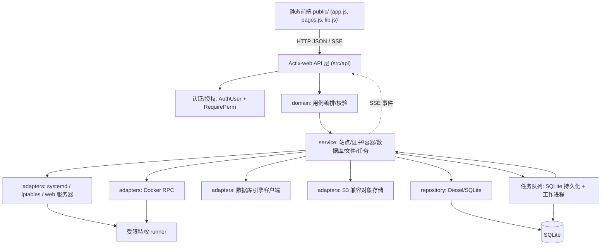
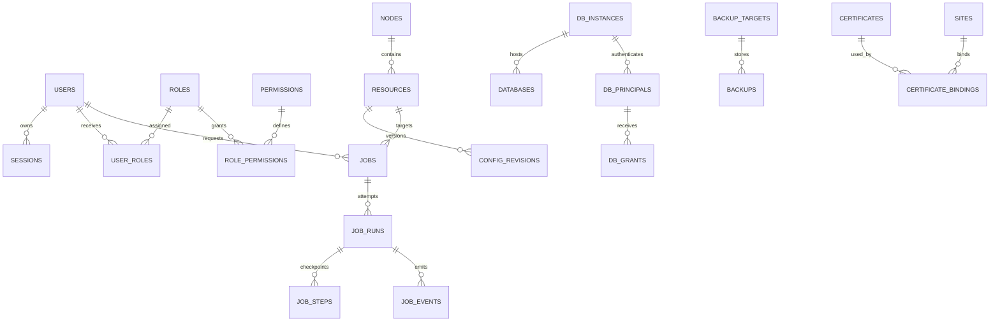

# RustPanel 开发文档：作为 1Panel 替代品的工程设计与路线图

> 文档版本：v0.2（工程设计与任务拆分稿）
> 更新日期：2026-10-10（Asia/Shanghai）
> RustPanel 代码基线：`dev` / `7d6050bdddc2210cb894006d36f68f71b6f55c67`
> 对标基线：1Panel 稳定版 `v2.3.2` / `65243c68c463cc055ab044093f641ea5d2e9e28b`（2026-09-24 发布；本次 GitHub latest API 返回）
> 本文是开发设计，不是已经完成的功能清单。仓库事实来自静态源码检查；架构、接口、支持矩阵、性能阈值均为建议，尚未做运行验证。
> RustPanel 为 Apache-2.0，1Panel 为 GPLv3；参考产品行为并独立实现，引入第三方代码时单独审查许可证。
> 入口：[项目仓库](https://github.com/sakuradairong/RustPanel) · [GitHub Projects](https://github.com/sakuradairong/RustPanel/projects) · [证据索引](#k4-引用索引)

读者导航：

- 产品范围和现状：A、B。
- 安全与后端基础：C、D、F、G。
- 模块实现与前端：E。
- 构建、验证、上线和迁移：H、I。
- 开发顺序、任务依赖和风险：J、K。

## A. 结论、范围与替代标准

### A.1 产品判断

RustPanel 已有登录、用户管理、文件、进程、systemd、Docker 资源、Nginx/Apache/Caddy 站点、ACME、iptables 和 SSE 监控的业务代码。它处于单机运维面板雏形阶段，本次未启动面板，不能由“路由存在”推断生产可用。

作为 1Panel 的替代品，最先需要完成的是**安全准入、可恢复的操作流程，以及网站—应用—数据库—备份的日常运维闭环**。Rust 实现可以提供清晰的类型与部署边界，但资源占用、可靠性和性能优势必须测量。

### A.2 可验收的替代标准

“实用替代”限定为单台 Linux 上的 Web 运维场景，在 M2 达成：

1. 从干净系统安装面板，创建站点，部署静态站点、反向代理和 PHP/WordPress 类应用。
2. 管理容器和 Compose，部署至少三种经过验证的应用模板，升级前备份且能恢复。
3. 管理 MySQL、PostgreSQL、Redis 的连接、账号权限和备份；按各引擎模型验收。
4. 通过面板配置 HTTPS、自动续期、历史监控、通知和定时任务。
5. 将备份保存到本地和 S3 兼容远端，在隔离实例完成恢复演练。
6. 普通运维人员通过受限权限完成操作；高权限动作有审计、失败处理和数据保护。
7. 用有版本契约的 API 执行自动化；安装、升级和从 1Panel 接管资源都有明确回退步骤。

应用商店与 Compose 是 M2 的核心交付；LLM、AI Agent 管理和 MCP 为后置扩展。M0/M1 可提前发布安全基础版和单机网站版，但不能据此宣称完整替代。

### A.3 首批平台与用户

| 维度 | 建议首批范围 | 扩展范围 |
| --- | --- | --- |
| 用户 | 自托管开发者、单机运维者、中小团队 | 托管服务商、多租户 |
| 操作系统 | Ubuntu 24.04 LTS、Debian 12，systemd | 其他发行版按实测加入 |
| CPU | x86_64、aarch64 原生验证 | 其他架构待需求 |
| 运维对象 | 单节点裸机/虚拟机，现有 Docker 和宿主服务 | 多节点、K8s |
| Web 服务器 | 三种已有适配器继续保留，首批完整演练优先 Nginx | Apache/Caddy 按各自行为验证 |
| 数据库 | MySQL 8.4 LTS、PostgreSQL 16/17、Redis 7，均先做兼容性探测 | MariaDB、MongoDB、其他版本 |

这些是候选兼容目标，不是已验证支持列表。先固定一套主线环境完成端到端，再扩大矩阵；不能因 ARM 上能编译面板就宣布安装器和全部应用支持 ARM。

### A.4 1Panel 版本和范围

本次核验的默认分支是 `dev-v2`，latest release 为 `v2.3.2`。以该稳定标签的 README、路由和公开源码为比较依据，避免使用旧 `dev` 分支代表当前产品。

该版本官方 README 明确列出网站、容器、数据库、商店、备份及 AI 管理；版本表把多节点列为 Pro/Ent、网站防篡改和网站可用性监控列为 Pro/Ent、KVM Web UI 和 AI Gateway 列为 Ent。本文不以付费版逐项对齐作为 M2 门槛。公开源码出现某能力不代表它在所有地域/授权条件下均可用；不引用宣传中的应用数量作为 RustPanel 交付目标。

### A.5 范围控制

首轮保留 Actix-web/Tokio/Diesel/SQLite 和原生 JS，按边界演进，不同时启动框架重写。Windows/macOS 原生安装、多租户计费、插件执行框架和 K8s Operator 不进入 M0–M2 关键路径。

“一个面板管理服务器”意味着拥有较高权限，不是多租户隔离产品。M2 的只读/运维角色只是可信团队的授权划分；容器特权、宿主终端和任意配置编辑必须是独立受限能力。

### A.6 三条用户旅程

| 旅程 | 流程 | 成功证据 |
| --- | --- | --- |
| 新建网站 | 安装 → 初始化 → runtime/应用 → 站点 → DNS/证书 → 备份计划 | HTTPS 访问正常，续期任务已登记，备份恢复校验通过 |
| 接管已有服务 | 探测 → 只读盘点 → 冲突报告 → 明确接管 → 托管记录 | 原数据不覆盖，配置校验通过，配置来源和资源所有权可追踪 |
| 故障恢复 | 告警 → 查任务/日志 → 选恢复点 → 隔离演练 → 维护窗口切换 | 恢复报告包含数据校验、耗时、RPO/RTO 和回退点 |


---

## B. 基于代码的能力矩阵

说明：

- 各源码证据使用 K.4 的固定提交链接；矩阵中的path:line用于本地定位。
- 状态定义：**已见实现**＝有真实业务处理代码；**部分**＝有接口但缺关键能力（鉴权/边界/持久化/校验）；**未见**＝本仓库未发现；**待实测**＝代码存在但正确性依赖运行验证。
- “1Panel 对标”仅用于说明差距，不表示 RustPanel 已具备同等质量。

| # | 能力 | 状态 | 本地证据（path:line） | 1Panel 对标 | 备注 |
| --- | --- | --- | --- | --- | --- |
| 1 | 登录 / JWT 签发与校验 | 部分 | `src/api/auth.rs:108`、`src/api/auth.rs:119`、`src/api/v1/login.rs` | 安全入口/MFA（core/router/ro_base.go） | SHA1 salt 口令；sub 携带 `SlimUser`（含 password 哈希，不含 salt）；见 C.1/C.2 |
| 2 | 用户 CRUD | 部分 | `src/api/v1/admin.rs:105`、`admin.rs:152/308/338` | 登录与安全设置已见；面板多用户/RBAC 的实际能力未完成核验 | 仅 admin/user 两类 |
| 3 | 权限模型（RBAC） | 部分 | `src/api/v1/admin.rs:81`（`require_admin`） | 本项目建议能力；不据此断言 1Panel 具有同等 RBAC | 无权限表/无统一中间件；见 C.3 |
| 4 | 文件浏览/读写 | 部分 | `src/api/v1/file.rs:16/33/62` | 文件管理（含压缩/权限/收藏） | 登录后按传入路径读/写；路径边界与软链待查；见 C.5 |
| 5 | 进程列表/结束 | 部分 | `src/api/route.rs:33`–`43` | 进程管理 | `kill/{pid}` 无额外策略 |
| 6 | systemd 服务启停 | 部分 | `src/api/route.rs:147`–`154`、`src/api/v1/service.rs` | 服务管理 | 按名称操作 systemd |
| 7 | Docker 容器/镜像/网络/卷 | 部分 | `src/api/route.rs:44`–`70`、`src/api/v1/docker.rs` | 容器 + Compose + 应用商店 | 直接用 bollard；无 Compose/商店 |
| 8 | Docker Compose / 应用商店 | 未见 | — | Compose 编排、应用商店一键部署 | 本仓库未见商店概念 |
| 9 | 网站：Nginx 站点 | 部分 | `src/api/route.rs:80`–`89`、`src/api/v1/webserver.rs` | 网站（域名绑定/伪静态/反代） | 建/删/启停/reload |
| 10 | 网站：Apache / Caddy | 部分 | `src/api/v1/sites.rs:27`–`149`、`src/models/webserver/apache.rs`、`models/webserver/caddy.rs`、`src/models/webserver/config.rs` | 网站/反向代理；未确认其 Apache/Caddy 管理覆盖 | handler 有 AuthUser；已有 configtest/validate 与创建失败清理，需补细权限、原子发布和 reload 失败恢复 |
| 11 | SSL / ACME 证书 | 部分 | `src/api/route.rs:113`–`129`、`src/api/v1/ssl.rs` | 证书签发/续期/部署/自签名 | 有 providers/accounts/issue/renew/deploy/upload/self-signed；续期调度与原子回滚待查 |
| 12 | 防火墙 / iptables | 部分 | `src/api/route.rs:71`–`79`、`src/api/v1/firewall.rs` | 防火墙（端口/IP/规则） | 直接操作 iptables，防锁死策略缺失；见 E.5 |
| 13 | 实时监控（SSE） | 部分 | `src/api/route.rs:130`、`src/api/v1/monitor.rs:128` | 监控（CPU/内存/磁盘/网络） | SSE 独立 token 校验，弱于 AuthUser，需统一；见 C.4 |
| 14 | 监控历史持久化 / 告警 | 未见 | — | 监控历史与告警 | 无 metrics 表/无告警规则 |
| 15 | 日志查看 | 部分 | `src/api/route.rs:22`–`26`、`src/api/v1/log.rs` | 日志（操作日志/系统日志） | 读取系统日志；无审计日志 |
| 16 | 系统信息 | 已见实现 | `src/api/route.rs:32`、`src/api/v1/os.rs` | 概览页 | 基础 os_info |
| 17 | 软件安装器（MySQL/PG/Redis/Nginx/Caddy/Apache/Docker） | 部分 | `src/api/v1/installer.rs:15/68/121`、`src/models/system/installers/{mysql,pgsql,redis,nginx,caddy,apache,docker}.rs` | 应用商店/运行环境 | **仅有安装器，不等于数据库日常 CRUD/备份管理**；授权仅 `AuthUser`，缺细粒度高权限检查；见 C.3 |
| 18 | 数据库日常管理（库/用户/权限/导入导出/备份） | 未见 | — | 数据库模块（MySQL/PG/Redis） | 属 P1 首批（见 E.3） |
| 19 | 计划任务 / 定时调度 | 未见 | — | 计划任务（cron/脚本/备份） | 属 P1 |
| 20 | 备份 / 恢复（本地/远端） | 未见 | — | 备份账号 + 云备份恢复 | 属 P1，S3 兼容 |
| 21 | 全局设置 / 面板设置 | 部分 | `src/service/conf.rs`、`src/service/global.rs` | 面板设置/安全入口/HTTPS | 无对外全局设置 API |
| 22 | 安装向导 / 初始化 | 部分 | `src/service/db.rs:22`（`panel.lock` 旁路安装） | 初始化向导 | 建表忽略错误、初始密码明文入库；见 C.1/C.3 |
| 23 | 开放 API / MCP | 部分 | `src/api/route.rs:14`（已有 `/api/v1` 业务 HTTP API） | 1Panel MCP Server | 业务 HTTP API 已存在；OpenAPI/作用域 Token 属 M2，MCP 属 M3 |
| 24 | 多节点 / 集群 | 未见 | — | v2.3.2 README：Pro/Ent 多节点 | M3 后置 |
| 25 | 审计日志 / 敏感字段脱敏 | 未见 | — | 操作日志审计 | 属 P0（见 C.10） |
| 26 | 版本化 schema 迁移 | 未见 | — | — | 无 migration 目录；见 F.3 |
| 27 | PHP/应用运行时 | 未见完整管理 | 现有安装器目录和 `public/app.js` 未见 runtime 生命周期 | `agent/router/ro_runtime.go` | PHP-FPM/扩展/配置/站点绑定是 M2 建站依赖 |
| 28 | Web PTY/SSH | 未见 | handler 清单未见 terminal | 公开 host/container terminal 视图 | M2，连接鉴权/限额/会话审计 |
| 29 | 国际化/可访问性 | 部分 | `locales/`、`public/app.js` | 多语言前端 | 后端翻译存在；前端英文内联文案与权限交互需收敛 |
| 30 | 依赖/发布供应链 | 部分 | `Cargo.toml`、`.github/workflows/rust.yml` | 稳定 Release 产物 | 缺可核验锁定、签名、SBOM 与跨架构发布流程 |
| 31 | 认证密钥初始化 | 部分（P0） | `src/service/global.rs:14–19` | 安全设置 | 环境变量缺失会使用公开固定 JWT/session key |
| 32 | 本地运维CLI/管理员恢复 | 部分（占位） | `src/bin/rp.rs:13` | 1Panel README有1pctl用户信息入口 | rp在Linux只输出OK；需要status/doctor/安全恢复/升级能力 |

### B.1 稳定版本对照依据

| 1Panel v2.3.2能力 | 一手证据 | RustPanel对应交付 |
| --- | --- | --- |
| 网站/SSL/商店/备份 | [P-README](https://github.com/1Panel-dev/1Panel/blob/65243c68c463cc055ab044093f641ea5d2e9e28b/README.md) | M1站点恢复；M2完整建站与商店 |
| MySQL用户/grants、PG、Redis、MongoDB | [P-DATABASE](https://github.com/1Panel-dev/1Panel/blob/65243c68c463cc055ab044093f641ea5d2e9e28b/agent/router/ro_database.go) | M2先三引擎，MongoDB后置 |
| PHP配置/FPM/扩展 | [P-RUNTIME](https://github.com/1Panel-dev/1Panel/blob/65243c68c463cc055ab044093f641ea5d2e9e28b/agent/router/ro_runtime.go) | M2 runtime闭环 |
| MFA、API key | [P-AUTH](https://github.com/1Panel-dev/1Panel/blob/65243c68c463cc055ab044093f641ea5d2e9e28b/core/router/ro_base.go) | M0会话与安全；M2作用域Token |
| 容器/应用生命周期 | P-CONTAINERS / P-APPS，见K.4 | M2 Compose+可信catalog |
| 计划任务/备份/告警 | P-CRON / P-BACKUP / P-ALERT，见K.4 | M1基础恢复，M2调度/远端/通知 |
| 多节点、网站监控/防篡改 | P-README版本表：Pro/Ent | M3按需求；不作为免费版替代门槛 |
| KVM、AI Gateway | P-README版本表：Ent | 后置，另行评估成本与范围 |

### B.2 证据边界

- 基线源码链接见 K.4。`未见` 表示本次搜索范围内没有完整实现；`部分` 不表示功能可以直接用于生产。
- 本次对 `src/api/v1/*.rs` 的公开 async handler 签名做静态清点：SSL handler 未见 `AuthUser`；多数其他业务 handler 使用该 extractor；login 为公开入口；monitor 自行检查 JWT。此清点不代替动态认证测试，也不排除 handler 内其他检查。
- Apache/Caddy 已有配置校验、创建失败后清理和单测，不能把这些功能再次列成完全缺失。仍需验证重载失败、删除/启停失败、并发修改和中途崩溃的恢复行为。
- Projects 匿名页面 HTTP 200，出现 Open 0 / Closed 0 / Loading，未取得具体看板条目。是否存在需要登录的 Project 未确认。任务表是本地规划，没有创建 GitHub 对象。
- 本次公共 REST API 的 issues 列表只有 PR #1/#2/#3，不能计作三个独立 Issue；milestones/releases 请求未获得条目。这是访问结果，不是长期仓库状态断言。
- 真实单测位于 `src/models/webserver/config.rs`、`apache.rs`、`caddy.rs`、`src/models/system/installers/caddy.rs`；`src/test/mod.rs` 为 DB demo。CI 当前只有 build/test。
- 1Panel 对照更新为稳定标签 `v2.3.2`。其默认分支为 `dev-v2`；旧 `dev` 不再作为当前基准。部分比较仅来自源码入口，运行可用性和商业授权仍须按安装版本核实。
- 国内文档入口重定向到 `docs.fit2cloud.com/1panel/`，本次未取得可读手册正文。依据是官方 README/API/源码，不声称手册全文研究。
- 本次没有编译、启动面板或执行宿主运维操作。文档结构和示例 SQL 的验证不等同于 RustPanel 功能测试。

---

## C. P0 生产准入风险（阻断上线项）

每项给出：现状（代码事实）→ 修复设计 → 验收标准。**未完成全部 P0 前不得对外宣称可用于生产。**

### C.1 口令哈希弱（SHA1 + 每用户 salt）与初始密码明文

- 现状：`src/api/auth.rs:108` `verify_password_sha1` 用 `sha1_salt`；另有 `src/bin/panel.rs:121`–`123` 直接把 `user.initial_password` 打印到日志，明文进入日志；`src/service/db.rs:39`–`52` 建表 `password TEXT(40)`、`salt TEXT(16)`、`initial_password TEXT(18)`；`db.rs:60`–`77` 生成随机初始密码并**明文写入 `initial_password`**；`db.rs:38` 建表用 `.ok()` 忽略错误。
- 修复设计：
  1. 引入 Argon2id（`argon2` crate），新增 `password_algo` 列（`sha1|argon2id`）。
  2. 保持旧哈希可验证：登录成功后若 `password_algo=sha1` 且验证通过，**即时重哈希**并写回 Argon2id。
  3. 移除 `initial_password` 明文列：一次性初始密码仅返回给创建者，落库只存哈希；历史数据迁移时置空并强制首次登录改密。
  4. 建表/迁移改为 fail-closed：`CREATE TABLE`/`ALTER` 失败必须返回错误而非 `.ok()` 忽略。
- 验收：新用户/改密后 DB 中无明文；旧 SHA1 用户能登录且登录后 `password_algo` 变为 `argon2id`；Argon2 参数有单测；建表失败时进程拒绝启动并输出明确错误。

### C.2 JWT 设计与撤销

- 现状：`src/api/auth.rs:119` HS256，`sub` 存 `SlimUser` 的 JSON（`SlimUser` 仅含 password 哈希字段、不含 salt，见 `src/models/structure/rp_users.rs`），密钥来自 `USER_PASSWORD_KEY`（`src/service/global.rs:14–15`）；缺环境变量时回退公开固定值（C.13）；`auth.rs:53` 用“DB 中 password 与 token 中 password 相等”判断令牌有效。
- 关键代码路径（静态事实）：`auth.rs:44`–`66` 在 `find_user_by_id` 失败时，`if let Ok(db_user)` 分支被跳过，随后仍会执行 `auth.rs:66` `ready(Ok(user))`，**即 DB 查询出错时凭 JWT 单独放行，非 fail-closed**；仅“用户不存在/密码不等”才拒绝（`auth.rs:60`、`auth.rs:53`）。
- 修复设计：
  1. `sub` 只放不可变 `user_id`（+ `jti`、`iat`、`exp`、`ver`），**不放 password/salt**。
  2. 新增 `sessions` 表（`jti_hash`、`user_id`、`issued_at`、`expires_at`、`revoked_at`、`ua_hash`、`ip`）；校验时查会话表，缺失或已撤销即拒绝。
  3. 收紧为 fail-closed：DB 错误返回503，解析错误或会话缺失返回401，均不得放行，**移除 `auth.rs:66` 的兜底放行**。
  4. 增加 `token_version`（用户级）+ 全局密钥轮换（`kid`），支持“登出所有设备”“禁用即失效”。
  5. 密钥不落静态常量：从环境变量/受限文件读取，启动校验强度与权限（见 C.7）。
- 验收：DB 不可用时所有需认证请求返回非 2xx；改密/禁用/登出后旧 token 立即失效；token 中不含任何口令字段；有会话表清理与过期任务。

### C.3 集中授权与 RBAC

- 现状：`src/api/route.rs:16` 的全局 `middleware::Auth` 被注释；`src/api/v1/admin.rs:81` 定义 `require_admin` 但仅用户 CRUD 使用；`src/api/v1/installer.rs:15/68/121`（列/装/卸软件）与 `src/api/v1/sites.rs` 各 handler 只用 `_: AuthUser`，**任何已登录用户即可安装/卸载系统软件、改站点**。
- 修复设计：
  1. 权限模型：`roles` / `permissions` / `role_permissions` / `user_roles`（见 F 节），权限点用 `resource:action`（如 `app:install`、`site:write`、`file:write`、`system:firewall`）。
  2. 统一提取器：`AuthUser` 只解决身份；新增 `RequirePerm("app:install")` 提取器或 actix 中间件，把 `require_admin` 泛化为 `require_perm`。
  3. 高风险动作（软件安装/卸载、Docker 特权、防火墙、文件写、服务启停）单独授权，禁止默认放行。
  4. 保留 admin/user 内置角色兼容旧数据，并映射到权限集。
- 验收：默认新建普通用户无法调用 installer/sites/firewall/file 写接口（返回 403）；权限变更对下一个请求即时生效；有覆盖主要资源×角色的集成测试。

### C.4 SSE 令牌与认证统一

- 现状：`src/api/v1/monitor.rs:128`–`149` 的 `monitor_sse` 自己从 header/query 取 token，仅 `decode_jwt(&token_str).is_ok()` 即放行——**不查 DB、不校验密码/会话/撤销**（对比 `auth.rs` 还查了 DB），且 query 传 token 易泄露到日志/引用头。
- 修复设计：
  1. 短期（≤60s）一次性 SSE 票据：认证接口签发 `sse_ticket`（含 `jti`、`user_id`、`exp`），SSE 连接用票据换取流，票据即时作废。
  2. 或者统一走 `AuthUser` 提取器（EventSource 无法设 header 时用票据端点换取短 cookie/票据）。
  3. 禁止把长期 JWT 放 URL query；日志中过滤 `token`。
- 验收：过期/已用票据连接被拒；`monitor_sse` 与 `AuthUser` 撤销语义一致；URL 中出现 token 的场景有测试保证不再泄露。

### C.5 文件 API 路径边界与符号链接

- 现状：`src/api/v1/file.rs:16/33/62`（list/save/content）登录后按请求传入路径读写。已有**简单过滤**：`file.rs:16`–`75` 使用 `contains("..")` 拒绝含 `..` 的路径；但缺少资源根目录白名单、绝对路径限制、符号链接解析与 TOCTOU（检查与使用之间竞态）策略。
- 修复设计：
  1. 定义受管根（默认 `/` 需显式开启“专家模式”，推荐按站点/应用目录配置允许根）。
  2. `canonicalize` 本身存在 TOCTOU（检查与使用之间路径可被替换）；Linux 上优先 `openat2(RESOLVE_BENEATH | RESOLVE_NO_SYMLINKS)`，或 dirfd + 逐段 no-follow 打开；新建文件需校验父目录并在同目录内原子 rename。拒绝 `..` 穿越与软链越界；只读/可写分级。
  3. 文件写入走受限 runner（见 D.3），限制大小、扩展名策略、原子写（临时文件 + rename）。
  4. 上传/解压：限制单文件与总量、条目数、路径穿越（zip slip）、压缩炸弹（比率/深度），解压产物同样做根校验（见 C.9）。
- 验收：越界路径（`..`、软链、绝对路径逃逸）返回 403；上传超限被拒；解压恶意包不产生根目录外文件；有专项测试集。

### C.6 命令执行参数白名单与超时

- 现状：多个模块通过调用系统命令实现功能（安装器、防火墙、webserver、service、process）。若命令由用户输入拼接，存在注入与“命令挂起”风险；本次未逐行确认拼接方式，属**待实测**。
- 修复设计：
  1. 所有外部命令经统一 `runner`：`Command::new(bin).args(&[..])` 数组传参，**禁止 `sh -c` 拼接用户输入**。
  2. 参数白名单/枚举（如服务名、站点名、chain、端口范围）在领域层校验。
  3. 强制超时（`tokio::time::timeout`）+ 输出上限 + 结构化退出码，超时杀进程组。
  4. 记录结构化审计（命令、参数脱敏、耗时、退出码、触发用户）。
- 验收：注入用例（`;`、`$()`、换行、空格）不改变执行语义；超时任务被终止并回传失败；审计包含触发者与 request-id。

### C.7 秘密加密与密钥管理

- 现状：`USER_PASSWORD_KEY` 等来自全局配置（`src/service/global.rs`）；DB 中存初始密码明文（`db.rs:71`）；无独立 secrets 表。
- 修复设计：
  1. 信封加密明确为：每个秘密生成随机 DEK，用 AEAD（AES-256-GCM / XChaCha20-Poly1305）加密数据；KEK 包裹 DEK，并记录 `key_version` 支持轮换。KEK 来自环境变量或 `/etc/rustpanel/master.key`（0600）。
  1b. 密钥备份/恢复需有演练；KEK 丢失即不可恢复，需在引导文档中明确。
  2. 敏感字段（DB 密码、ACME 私钥口令、S3 密钥）一律密文入库，解密仅在内存、生命周期最短。
  2b. API Token 例外：只能用**不可逆 hash** 存储（校验时比对 hash），不得存可恢复密文；Token 需作用域与过期。
  3. 支持密钥轮换（`key_id` 版本化）与启动自检（缺失/弱密钥即拒启）。
  4. API 响应与日志统一脱敏（见 C.10）。
- 验收：DB 文件离线检索不到明文秘密；轮换后旧密文可解；无密钥时面板拒绝启动。

### C.8 TLS / bootstrap / 首启

- 现状：`src/service/db.rs:22` `install` 通过 `./panel.lock` 存在直接 `return` 旁路初始化；`db.rs:79` 初始化后创建 lock 文件；初始管理员随机生成。
- 修复设计：
  1. 首启流程独立成 `bootstrap`：生成一次性管理员口令（打印到受控 stdout/文件，仅一次），强制首登改密。
  2. 面板自身 HTTPS：支持自签（本地）与 ACME（有域名）；默认仅监听 `127.0.0.1` + ssh 隧道，或显式绑定时强制 TLS。
  3. 安全入口（security_dir，`src/api/route.rs:20`）随机化并可在设置中轮换。
  5. `src/bin/panel.rs:158` 目前 `cookie_secure(false)`：会话 cookie 不强制 `Secure`；启用 TLS 后必须改为 `true`，并补 `HttpOnly`/`SameSite`。
  4. 安装与 schema 迁移 fail-closed（见 C.1）。
- 验收：全新环境首启必须改密；未配置 TLS 时不会以明文 HTTP 暴露到 0.0.0.0；重复启动不会重复初始化。

### C.9 供应链与镜像

- 现状：`Cargo.toml` 中 `bollard="*"`（无版本锁定）；安装器会拉取/编译软件；无 SBOM、无签名校验流程可见。
- 修复设计：
  1. 锁定依赖（`Cargo.lock` 入库、移除 `*`；`cargo-deny`/`cargo-audit` 进 CI）。
  2. 软件安装供应链：优先发行版包/官方源，校验 GPG/校验和，固定版本，记录来源与哈希；镜像仅从白名单 registry，校验 digest 而非 `latest`。
  3. 发布产物签名（cosign/minisign）+ SBOM（`cargo cyclonedx` / `syft`）。
  4. 升级回滚：保留上一版本二进制与静态资源，失败自动回退（见 H.5）。
- 验收：CI 拦截已知漏洞与未锁版本；安装记录含来源与哈希；发布附 SBOM 与签名，验证脚本可复跑。

### C.10 审计日志与敏感字段脱敏

- 现状：未见审计表；`src/api/v1/log.rs` 为系统日志读取。
- 修复设计：`audit` 表记录 `who/when/request_id/action/resource/params_masked/result/ip`；对 `password`、`token`、`secret`、`authorization` 统一脱敏。
  - 高风险动作（安装/卸载、防火墙、文件写、证书部署）采用 **intent/outbox**：执行前先持久化 intent，写入失败则**拒绝执行**；执行结果异步落库，落库失败告警并进入补偿队列。
  - PTY/终端：只能保证会话、连接、输入输出（可选脱敏）录制，**不能可靠解析或保证完整命令审计**，不得据此做安全判定。
- 验收：任意高危写操作在**执行前**已有持久化 intent；导出/日志中检索不到明文口令与 token；审计表可独立轮转与归档。

### C.11 root 权限拆分

- 现状：面板进程需执行特权系统操作（systemd、iptables、文件、Docker socket），推断以高权限运行；未见特权分离。
- 修复设计：面板主进程降权运行；特权操作通过**受限特权 runner**（独立小二进制/sudoers 白名单/Polkit）执行，只暴露枚举化动作，最小参数面。
- 验收：主进程非 root，且不加入 docker 组、不持有宿主 Docker socket；runner 只接受白名单动作 ID + 结构化参数；越界动作被拒并审计。

### C.12 SSL 敏感接口缺认证（严重）

- 现状（静态路由与代码事实）：`src/api/v1/ssl.rs` 的全部 `pub async` handler **均无 `AuthUser` 参数**——`setup_certbot:167`、`register_acme_account:386`、`issue_certificate:538`、`delete_certificate:681`、`deploy_certificate:725`、`upload:843` 等；`src/api/route.rs:16` 的全局 `middleware::Auth` 为注释行，`src/bin/panel.rs:144` 同样是注释，`panel.rs:152`–`164` 只挂载 `SessionMiddleware`，**不构成认证门禁**。
- 结论：按静态路由结构，`/api/v1/ssl/*` 存在未认证访问面的高风险，**须以集成测试验证**；不能仅以“RBAC 不足”概括，应单列为 P0 认证缺失项。
- 修复设计：所有 SSL 敏感 handler 强制 `AuthUser`，再按读/签发/部署/删除声明具体权限；不得把通配符作为默认授予；`/ssl/setup`（安装 certbot）与 `/ssl/deploy` 归入高权限；启动时断言不存在“未挂认证的敏感 router 段”。
- 验收：无凭据调用全部 ssl 端点返回 401；非授权角色返回 403；ssl 路由集成测试纳入 CI 门禁。
### C.13 公开固定密钥回退与重复的前端加密

- 代码事实：[global.rs:14–19](https://github.com/sakuradairong/RustPanel/blob/7d6050bdddc2210cb894006d36f68f71b6f55c67/src/service/global.rs#L14) 在 `RP_SECRET_KEY` / `RP_SESSION_KEY` 缺失时使用源码中的固定值；本次不复制这些值到文档。JWT 签名直接使用前者。`App.secret_key` 有配置字段，但不能假设修改 YAML 就修改了实际 JWT key。
- `common/fun.rs:37–59` 实现登录 SM4 与固定文件 SM4 key；`models/file.rs:45` 最终写入解密后的内容。文件 API 的应用层加密不是磁盘加密，也不提供 TLS 的服务端身份校验。
- 修复：首启通过 OS CSPRNG 生成每实例密钥，以 root 可读受限文件/secret 管理；取消任何公开默认 key。配置只有一个权威来源，缺失/长度错误拒绝启动，明确升级时旧 token 全部失效。
- 登录迁移到 HTTPS 下的标准请求；文件读写使用 TLS 传输，过渡期支持旧协议时必须记录版本并限期移除。不要把 security_dir 或客户端 SM4 当认证强度来源。
- 验收：两个新实例生成不同密钥；删掉 key 文件不能以默认值继续启动；修改 YAML 不会产生“显示已换 key、实际仍使用旧 key”的配置漂移；token 中无 password，磁盘秘密保护按 C.7 验收。

### C.14 威胁边界与操作分类

| 输入/边界 | 主要风险 | 必需控制 |
| --- | --- | --- |
| 浏览器/API 请求 | 越权、XSS、CSRF、重放 | 认证+资源授权；转义/CSP；cookie 路径启用 CSRF；nonce/版本/幂等 |
| 下载 URL/反向代理/DNS/S3 | SSRF、泄露凭证、恶意源 | URL scheme/目标策略、DNS 重解析、禁元数据地址；内网目标需单独授权 |
| 导入文件/压缩包 | zip-slip、炸弹、超大文件 | dirfd 边界、字节/条目/时间限制、临时空间配额 |
| Docker/Compose/宿主 runner | 宿主提权、设备挂载、任意执行 | 容器 privilege/cap/device/host mount 独立权限；runner 同时验证资源归属 |
| 管理员终端/原始配置 | 意图就是高权限执行 | 默认只 admin 可用，近期再认证；不能把命令提示当沙箱 |
| 恢复与卸载 | 用户数据删除、旧写覆盖 | 预览影响范围、备份点、数据保留默认值、执行前再确认版本 |

默认角色建议为 admin / operator / viewer：viewer 只读并遮蔽 secrets；operator 只能操作已授予资源，默认没有终端、宿主原始配置、密钥导出和用户管理权。admin 也不能绕过安装覆盖保护和恢复计划检查。

登录采用账号+IP 双维度限流、退避和可恢复锁定；错误信息避免泄露账号是否存在。账号禁用/role 变化在每次请求与新 SSE 连接重新读取权威状态。MFA（TOTP + hash 存储恢复码）可作为高权限场景要求，但不妨碍先修复直接认证缺口。


---

## D. 目标架构

### D.1 演进原则

沿用 Actix-web 4 + Tokio + Diesel/SQLite + 静态 JS（`Cargo.toml`、`src/api/*`、`public/`），**不做无理由重写**。演进方式：把 `src/api/v1/*.rs` 里的业务逻辑下沉到 `domain`/`service`，把系统交互收敛到 `adapters`，HTTP 层只做协议与鉴权。

### D.2 单机组件图



### D.3 分层和可测试接口

| 层 | 拥有什么 | 不应依赖什么 |
| --- | --- | --- |
| domain | 资源标识、授权策略、配置不变量、任务状态机 | HTTP、文件系统、Diesel |
| service | 一次用户用例、事务/补偿、资源锁、审计 intent | HTTP request/response 类型 |
| adapters | Docker、systemd、Web 服务器、数据库/S3 的具体协议 | 页面状态和菜单 |
| repository | SQLite 事务、版本、查询、outbox | 调用 systemctl、等待网络 |
| api | DTO、提取身份/权限、错误映射、任务响应 | 原始 shell 拼接和业务 SQL |
| privileged runner | 受控宿主动作、参数校验、资源边界 | 前端 token 解析和菜单角色 |

建议 trait 按用例定义，例如 `WebServerAdapter::{inspect,validate,publish,reload,restore}`、`BackupAdapter::{prepare,stream,verify,restore}`、`CommandExecutor::execute(action,context)`。避免一个万能 `execute_shell(String)` 接口。

runner 使用受限 Unix socket，文件所有权限制连接者，并校验 SO_PEERCRED。请求携带服务端构造的 job_id、actor_id、resource_id、action、expected_revision；这些字段用于追踪，不是独立认证凭证。runner 用自己的资源白名单重新验证路径、命令和参数，不能只相信 HTTP 已经校验。

不把主进程加入 docker 组，否则“非 root”仍可通过 Docker socket 控制宿主。Docker 高风险调用也经过 runner；只读代理必须过滤 inspect/env/日志中的 secrets。M2 默认关闭 privileged/host network/宿主任意挂载，启用需独立授权并告知影响。

数据库同步调用放进有上限的 blocking pool；异步 HTTP/外部命令加超时、kill-on-drop 和子进程组清理。对外系统调用不持有 SQLite 写事务。

### D.4 持久化任务、锁与崩溃恢复

队列采用 **至少一次投递 + 幂等/外部状态核对**，不承诺 exactly-once。SQLite 使用 WAL、foreign_keys、busy_timeout 和短事务；同一时刻仍只有一个 writer，没有行级写锁。

| 状态 | 允许后继 | 恢复规则 |
| --- | --- | --- |
| queued | running, canceled | 可安全取消 |
| running | succeeded, failed, cancel_requested, interrupted | heartbeat 更新租约 |
| cancel_requested | canceled, succeeded, interrupted | 请求已记录；到可取消检查点停止，不保证即时 |
| interrupted | queued, reconciling, manual_review | 先确认外部动作是否已经发生 |
| reconciling | succeeded, failed, queued, manual_review | 查询资源实际状态，禁止无依据重复安装/恢复 |
| manual_review | queued, failed | 人工选择重试/补偿并审计 |
| succeeded / failed / canceled | 无 | 终态；重试建立新 run |

领取任务时在 `BEGIN IMMEDIATE` 短事务里选择 queued 项、条件更新 state/worker_id/lease_until 并提交；另一个 worker 更新影响行数为 0 时不得执行。heartbeat 用 run_id+worker_id+fencing_token 条件更新。续租失败立即停止新动作；已开始的外部命令也要 runner 判断操作租约。

单资源锁键为 `node:resource_kind:resource_id`，跨资源动作按照固定排序取锁。DB 中持久化 owner、租约和递增 fencing token，防止旧 worker 在租约过期后继续提交配置。SQLite 锁租约不能自动阻止外部 shell 的副作用，因此 runner 需检查持久化 fence，并对配置提交再校验 revision。锁释放后保留单调fence计数，不能删除后从0重建。对恢复/安装等长动作，runner还需持有资源级OS锁直到子进程确定结束；租约失效的未知动作转manual_review，不能立即启动另一份恢复。

任务包含 request_id、actor_id、resource_id、params_ref、step checkpoint、compensation_plan。日志持久化单调 event_id；SSE 使用 Last-Event-ID 重放有限范围，溢出后返回明确“重新加载任务状态”，不静默漏行。秘密参数仅保存 secret_id。

建议初始配置：通用任务并发 2、重型备份/恢复同节点并发 1、租约 30 秒、10 秒续租、命令超时按 action 分类；都是待实测的安全起点，可配置且有上下限。磁盘满时停止接纳新写任务并报警，不依靠无限重试。

任务执行顺序：权限与配额 → 获取资源锁 → 持久化审计 intent → 外部动作 → 结果校验 → SQLite 短事务更新 observed/revision+audit result → 释放锁。中间失败以 checkpoint 决定补偿；涉及用户数据的不可逆步骤转 manual_review。

### D.5 现有目录 → 建议目录映射

| 现状 | 目标 |
| --- | --- |
| `src/api/route.rs`（全部路由） | 按域拆 `src/api/routes/{sites,certs,docker,db,files,jobs}.rs`，`route.rs` 仅聚合 |
| `src/api/v1/*.rs`（handler 含逻辑） | handler 薄化 → `src/domain/*` + `src/service/*` |
| `src/models/system/installers/*` | 升级为 `src/adapters/installers/*` + 声明式应用清单 |
| `src/models/webserver/*` | 保留为 `src/adapters/webserver/*`（Apache/Caddy/Nginx） |
| `src/service/db.rs`（建表/初始化） | 拆 `src/repository/migrations/*` + `src/bootstrap.rs` |
| `src/service/global.rs`（CONF/密钥） | `src/config.rs` + `src/secrets/*`（信封加密） |
| `public/*.js` | 保留，后续按页面拆分模块，不引入构建链（可递增） |
| 无 | 新增 `src/jobs/*`（队列/执行器）、`src/privileged/runner.rs`、`src/audit/*` |

### D.6 多节点（后置）

M3 引入节点抽象：`nodes` 表 + gRPC/HTTP 代理到远端 agent（与主进程同源，跑同一 runner）。本阶段仅预留 `node_id` 字段与适配层接口，不实现调度。

### D.7 资源所有权和配置发布

资源分三类：`discovered`（探测到，仅只读）、`adopted`（用户明确接管，保存原配置和数据位置）、`managed`（面板创建）。默认不能改写 discovered 资源；接管前有冲突检查、备份和影响预览。

每个资源分别记录 desired、observed、revision、last_probe 和 origin。外部手动编辑导致 drift 时告警并展示差异，不能自动覆盖。用户选择“接受外部变化”或“重新发布面板版本”，后者需 expected_revision 校验。

配置发布记录 proposed → validated → committed → verified / rollback_failed。单文件可用 fsync+rename；多文件没有跨文件原子保证，需版本目录/原子切换入口或维护窗口。Web 服务器校验要针对完整候选配置，不能用旧活动配置通过检查后就覆盖新文件。切换后 reload+健康探测失败，恢复上一配置并再次 reload；恢复失败转 manual_review，禁止报告成功。


---

## E. 模块规格

每个模块给出：UI、后端、数据、异常流程、验收。已有能力（Apache/Caddy 站点、ACME、Docker 资源）保留并增强，不推倒重来。

### E.1 网站与证书

- UI：站点列表（Nginx/Apache/Caddy 分组）、建站向导（域名、根目录、PHP/静态/反代）、证书绑定与自动续期、配置预览与回滚。
- 后端：已有 Apache/Caddy 的 test_config 和创建失败清理继续复用。保留 `src/api/v1/webserver.rs`、`src/api/v1/sites.rs`、`src/api/v1/ssl.rs` 与 `src/models/webserver/{apache,caddy,config}.rs`；新增证书状态机 `pending→issuing→issued→deploying→active→renewing→expired/failed`。
- ACME：HTTP-01 与 DNS-01 挑战（DNS 用可插拔 provider，凭证走 C.7 加密 secrets）；续期任务进入队列（D.4），到期前 30/7/1 天分级重试。
- 配置写入：模板渲染 → 语法校验（`nginx -t` / `apachectl configtest` / `caddy validate`）→ 原子替换 → reload → 失败自动回滚上一版本。
- 数据：`sites`、`certificates`（见 F）。
- 异常：校验失败不得 reload；reload 失败回滚；ACME 限流退避；私钥仅 0600 且不入库明文。
- 验收：建站到 HTTPS 可用全流程可重复；续期无人工介入；任一步失败系统保持上一可用配置。

### E.2 Docker / Compose / 应用商店

- UI：容器/镜像/网络/卷（已有）、Compose 编排、应用商店（分类、一键部署、参数表单）。
- 后端：现有 `src/api/v1/docker.rs`（bollard）保留；新增 Compose 解析与实际部署（docker compose 或 API 编排）。
- 商店：**可信 manifest**（含版本、镜像 digest、环境变量、端口、卷、健康检查、依赖、升级/回滚脚本），来源签名校验，拒绝 `latest` 与无名镜像。
- 数据：`apps`（安装实例）、`resources`（端口/卷占用）。
- 异常：端口/卷冲突前置检测；部署失败只清理**本次创建且无用户数据**的容器/临时资源，**持久卷默认保留**；容器版本回滚不等于应用数据 schema 回滚，升级前必须备份，恢复需显式确认。
- 验收：一键部署→健康检查通过→可升级→可回滚→可卸载清理；manifest 篡改被拒。

### E.3 数据库

- 首批：MySQL、PostgreSQL、Redis（1Panel 对标见 `database/mysql/create/index.vue`）。
- 能力：连接管理、库/账号/权限 CRUD、导入导出、一致性备份与恢复、慢查询/状态查看。三种引擎模型不同，**不可用同一套“建库/建用户”验收**：
  - MySQL：database / account / grants（`GRANT` 粒度）；备份用 transactional dump，非事务表（MyISAM 等）需单独策略（锁表/短暂停写）并显式记录。
  - PostgreSQL：database / role / schema / grants；备份/恢复走 `pg_dump` / `pg_restore`，注意版本兼容。
  - Redis：无 SQL 建库，只有逻辑 DB 索引（0..N）与 ACL（key pattern/命令白名单，**需版本探测**）；备份用 RDB/AOF 并检查持久化状态一致性。
- 现状约束：`src/models/system/installers/{mysql,pgsql,redis}.rs` **只是安装器**，不等于数据库日常管理。安装器本身需修：`src/models/system/installers/mysql.rs:24` 仅提供 x86_64 下载（aarch64 **能力待验证**），`mysql.rs:41`–`43` 对既有目录执行 `remove_dir_all`——**安装前必须做不可覆盖的数据保护/显式确认**。
- 数据：`db_instances`、`databases`（见 F）；连接密码走 secrets。
- 异常：备份前一致性（锁/快照）；恢复前强制备份；导入大文件超时与断点策略。
- 异常与验收：备份只恢复到**隔离实例**验证后再切换；错误版本拒绝操作（版本探测前置）；覆盖安装器数据保护用例（“目标目录非空时拒绝安装”）。各引擎按上文各自清单验收。

### E.4 文件与终端（PTY / SSH）

- UI：文件管理（列表/编辑/上传/下载/解压/权限）、终端（本地 PTY 与 SSH 会话），对标 `host/terminal`、`host/file-management`。
- 后端：`src/api/v1/file.rs` 保留并叠加 C.5 的根目录与符号链接策略；新增 PTY/SSH 会话管理与审计。
- 数据：会话短期驻留内存；持久化连接者、目标、开始/结束、状态与可选脱敏输入输出。不可靠地解析 shell 命令，不承诺完整“命令审计”。SSH 校验 host key，首次信任和 key 变化有明确确认。
- 异常：断线重连、并发会话上限、会话空闲超时、危险命令提示。
- 验收：连接需 terminal 权限与一次性票据；禁用用户断开连接；PTY 尺寸/UTF-8/断线清理正确；会话可追踪并按策略录制；超时断开。

### E.5 systemd 服务与防火墙（防锁死）

- UI：服务列表/启停/状态（已有 `service.rs`）、防火墙规则与端口开关。
- 后端：`src/api/v1/service.rs`、`src/api/v1/firewall.rs` 保留；防火墙新增**防锁死**：变更前保存当前规则；**本机自检不足**，需**独立 watchdog** 在超时后自动回滚，并由**新连接外部确认**（面板端口/SSH 可达）后才 commit；覆盖 iptables / nft / ufw / firewalld 的**所有者检测**，禁止多个控制器混写同一规则集；面板自身端口默认白名单。
- 数据：`audit` 记录规则变更；规则快照可用于回滚。
- 验收：模拟错误规则不会把操作者锁在门外；自检失败必回滚；所有变更可审计。

### E.6 监控与告警

- UI：实时面板（已有 SSE）+ 历史曲线 + 告警规则与通知渠道。
- 后端：`src/api/v1/monitor.rs` 保留采集，新增周期落库（降采样）与告警评估；SSE 鉴权按 C.4 统一。
- 数据：`metrics`（见 F）；保留策略（原始 7 天 / 降采样 90 天，示例值待定）。
- 验收：历史查询可用；阈值触发告警且可静音；无数据时不误报。

### E.7 计划任务与备份 / 恢复

- UI：计划任务（cron/脚本/备份）、备份账号（首批仅 **S3 兼容 / MinIO**，对标 `setting/backup-account/minio`；腾讯 COS、七牛 kodo 等为**单独适配、待定**）、记录页（对标 `cronjob/record/index.vue`）。
- 后端：调度器（单机用队列 + cron 解析）→ 备份任务（本地/远端）→ 保留策略 → **恢复演练**。调度器需明确：时区（含 DST 边界）、misfire 策略、**禁止重叠执行**（同任务单实例）与失败重试上限；备份链为压缩+加密+校验 manifest（哈希），**保留策略只能删除“已完成且不破坏恢复链”的对象**，远端对象启用 versioning。
- 数据：`schedules`、`backups`、`jobs`/`job_runs`（见 F）。
- 异常：任务失败重试与告警；并发单实例锁；远端不可达不阻塞面板。
- 验收：定时任务按计划执行、可手工触发、可取消；备份可列出/下载/恢复并留下记录；保留策略生效。

### E.8 全局设置 / 导入迁移 / 开放 API

- UI：面板设置（安全入口、TLS、会话时长、通知）、导入/迁移、API Token 管理。
- 后端：`src/service/conf.rs`、`src/service/global.rs` 收敛为 `config`；新增版本化迁移与导入导出（配置文件 + 可选 secrets，导出默认不含明文秘密）。
- 开放 API：Token（作用域 + 过期）+ 与内部 RBAC 同一权限检查；MCP 作为 M3 后置（对标 `1Panel-dev/mcp-1panel`）。
- 验收：设置项变更即时生效且可审计；导入在版本不匹配时拒绝或显式迁移；API Token 可撤销。

### E.9 UI 工程规格

- 保留 `public/` 形态，逐步拆成 shared/api、auth、components、pages、i18n；先统一网络层、表格/分页、表单验证、弹窗和任务面板，不重复实现整套组件。
- 中文/英文文案集中管理；状态、日期/时区、字节单位、错误码转换一致。后端 locales 的存在不等于前端已国际化。
- 菜单与按钮按能力控制，服务端仍强制授权。危险操作展示节点、路径/库/卷、影响对象和数据保留策略；恢复/删除需要输入对象名称或明确确认执行计划。
- 长任务立即显示 job_id、进度未知时使用阶段描述，支持离开页面后重新查看。区分 empty/error/loading/disconnected/forbidden；401 到期进入重新登录，403 保留页面解释缺少权限。
- 用户输入不得拼入 innerHTML；输出日志、文件名、镜像名、SQL 错误使用 textContent 或可信转义。设置 CSP，禁止动态 eval；大文件编辑、日志查询和表格分页限制浏览器内存。
- 建议短期 access token 驻留内存，refresh cookie 为 Secure/HttpOnly/SameSite；cookie 认证写请求同时做 CSRF+Origin 校验。旧 localStorage bearer 可过渡读取后清理，协议版本不能长期双栈。
- 支持键盘操作、焦点回归、表单 label、对比度、移动端表格；shell/编辑器可声明桌面优先，但不能让移动端误点危险动作。

### E.10 运行时与应用依赖

M2 首批实现 PHP-FPM runtime（版本、扩展、配置、健康状态、站点绑定）与通用反向代理 runtime；Node/Python/Java/Go 优先通过可信 Compose 模板，不同时构建五套宿主安装器。

runtime 与 site 是多对一，记录 image digest/宿主路径、端口/socket、配置 revision、关联站点和 secrets。删除 runtime 前列出依赖，存在站点时返回冲突；升级需检查扩展兼容、PHP-FPM 健康与站点 smoke test。

Nginx/Apache/Caddy 证书行为不同。Caddy 原生自动 HTTPS 与面板 ACME 只能有一个续期责任方，证书来源记为 managed_acme / caddy_auto / uploaded；不能对同域名启动两个自动续期控制器。站点域名做 IDNA/大小写规范化，DNS-01 wildcard 和 HTTP-01 可达性分别校验。

### E.11 应用清单契约（建议）

首批目录只收录经过演练的模板，例如静态站点、WordPress+MySQL、一个无数据库服务；模板数量是验证范围，不是宣称现已提供。

```yaml
schema_version: 1
key: example-web
version: "1.0.0"
architectures: [amd64, arm64]
compose_ref: catalog/example-web/1.0.0/compose.yaml
# 演示占位；真实 manifest 必须填已校验 digest，禁止把占位值部署。
images:
  - name: example/web
    digest: "<verified-sha256-digest>"
inputs:
  - name: public_port
    type: port
    required: true
  - name: admin_password
    type: secret_ref
    required: true
healthcheck:
  type: http
  path: /health
volumes:
  - name: data
    retention: keep
upgrade:
  backup_required: true
  data_schema_compatible: false
```

目录版本签名和镜像 digest 分别验证；registry tag 只用于用户显示。Compose 校验展开后的配置，包括隐式 env_file、build、cap_add、devices、host namespace、socket 挂载和相对路径。M2 默认禁止 catalog 中任意 shell hook；确需 migration hook 时用受审核 action_id、执行身份和超时。

离线安装导入同一签名清单和镜像归档；网络失败/registry 凭证错误不会被当成“模板无应用”。不同架构必须解析对应 manifest digest并实测健康，不能只更改下载文件名。

### E.12 模块失败和验收场景

| 模块 | 正常验收 | 必测失败 | 保留数据/回退 |
| --- | --- | --- | --- |
| 站点 | 创建静态/代理/PHP；域名/TLS生效 | 配置错误、reload 失败、外部修改 | 原活动配置不被损坏，drift不覆盖 |
| 证书 | staging 签发、续期、部署与访问 | DNS授权失败、限流、私钥不匹配 | 旧有效证书继续服务 |
| 应用 | 参数校验、健康、升级、卸载 | 端口冲突、镜像不支持架构、schema迁移失败 | 持久卷保留；明确备份恢复方案 |
| 数据库 | 三引擎按各自模型建对象/权限 | 错凭证、断网、版本错、空间不足 | 不静默删库；隔离恢复后切换 |
| 文件 | 受管目录CRUD、大文件流式下载 | symlink交换、越界、压缩炸弹 | 原文件完整，临时文件可回收 |
| 防火墙 | 外部新连接确认生效 | worker崩溃/错误deny/控制器冲突 | 独立watchdog恢复上一规则 |
| 备份 | manifest验证、本地/远端恢复 | 上传中断、缺key、破损包 | 不删除最后一个已验证恢复点 |
| 计划任务 | 时区/DST/错过运行策略可预测 | 执行过长/重启/通知失败 | 同任务不重叠，历史run不重复成功 |
| 终端 | 可信用户连接/尺寸调整/正常退出 | 错host key、票据重用、禁用用户 | 新连接拒绝，活动会话关闭并记录 |


---

### E.13 运维CLI和管理员恢复（目标）

`src/bin/rp.rs` 目前没有完整命令解析和运维子命令，Linux分支主要输出OK。下表是建议新增契约，不能把它当作现有可执行命令使用。

| 建议命令 | 行为 | 身份与保护 |
| --- | --- | --- |
| rp status / version | 显示服务/产物/schema/健康 | 只读；敏感配置遮蔽 |
| rp doctor --redacted | 配置来源、DB/key权限、socket/端口、空间、依赖诊断 | 报告不含key/token/密码，不静默修复宿主 |
| rp auth reset-admin | 本地设置新口令、撤销管理员会话 | root/指定恢复身份+TTY输入，不能命令行传明文password |
| rp config check | 解析YAML/依赖/权限并显示脱敏结果 | 不启动Webserver或更改业务资源 |
| rp backup panel | 一致性备份SQLite/配置元信息 | secret导出另需保护与明确选择 |
| rp upgrade / rollback | 校验已签名产物并执行版本计划 | 版本/schema预检；旧包与匹配DB恢复 |
| rp jobs reconcile | 检查interrupted/manual_review及实际资源 | 默认只读，应用补偿必须给具体计划 |

CLI与服务共用application service/repository，不复制另一套密码/迁移逻辑。离线修改先获取专用维护锁并停止冲突写入，验证schema与二进制匹配；操作完成将审计intent/result写到恢复日志，在线后并入统一审计。

管理员恢复不是输出历史明文初始口令。设置新Argon2id口令，提升token_version并撤销现有session；身份和动作留痕。丢失KEK时不能声称可恢复secrets，必须使用经过演练的密钥备份，否则只可重建对应凭证。

---

## F. 数据模型

### F.1 模型约束

时间统一存 UTC epoch milliseconds，API 使用 RFC3339；调度保留 IANA timezone。ID 用 UUID/ULID opaque string，不能作为权限边界。需要资源版本的表有 revision，更新使用 compare-and-swap；没有匹配 revision 返回 409。

SQLite 外键在每个连接启用 `PRAGMA foreign_keys=ON`，WAL/busy_timeout 按部署配置设定。不要把字段名里出现“用户”就混用面板用户和数据库引擎账号。

### F.2 表与关系（建议新增）

| 表 | 关键列/关系 | 约束与生命周期 |
| --- | --- | --- |
| users | username, password_hash(PHC), status, token_version | username unique；不存明文 initial_password |
| roles / permissions | role code / action code | 内置角色受保护；权限通配符展开后校验 |
| user_roles / role_permissions | 两端外键 | 复合主键，删除用户撤销会话 |
| sessions | user_id, jti_hash, refresh_hash, exp, revoked_at, version | refresh rotation/replay检测；expiry索引 |
| api_tokens | owner_id, token_hash, scopes, expiry, revoked_at | 创建时只显示一次；不保存可恢复明文 |
| secrets / secret_keys | ciphertext, nonce, wrapped_dek, key_id, purpose | 明确引用与轮换；key文件不与DB同包无保护导出 |
| nodes | id, name, local flag, endpoint, state | M0–M2只有local；预留外键不等于实现多节点 |
| resources | node_id, kind, external_id, origin, revision, desired/observed refs | node/kind/external_id unique；禁止删除仍被依赖资源 |
| resource_bindings | resource_id, kind(port/path/volume), value | node+协议+绑定地址+port等具体规范化后判冲突 |
| sites / site_domains | server_id, runtime_id, config_revision, root, domain | domain规范化+冲突检测；网站关系一对多 |
| config_revisions | resource_id, content_hash, artifact_path, state, prior_revision | 保留受限数量；未经验证不可活动 |
| certificates / certificate_bindings | issuer, SAN, serial, expiry, source, secret_ref, site_id | 一证多站点；secret不能通过read权限取得 |
| runtimes | engine, version, resource_id, config_revision, health | 删除前检查site依赖 |
| app_catalog / apps | manifest_hash, catalog_version / installed params refs, status | 模板不可变；实例参数秘密使用secret_ref |
| db_instances / databases | engine, endpoint, admin_secret_ref / instance_id,name | 面板账号与DB账号独立；Redis逻辑DB模型单独存kind |
| db_principals / db_grants | mysql_account/pg_role/redis_acl, identity, secret_ref / scope, privileges | MySQL identity含host；scope必须按引擎校验 |
| jobs / job_runs / job_steps | actor_id, request_hash, resource_id / attempt,worker,fence,lease / checkpoint | attempt unique；终态不可直接重写为running |
| resource_locks | resource_id, owner_run_id, fencing_token, lease_until | resource_id unique，令牌单调递增 |
| idempotency_keys | actor_id, action, key_hash, request_hash, job_id, expiry | actor/action/key_hash unique，body不符409 |
| job_events | run_id, seq, redacted_payload, created_at | run_id/seq unique；有界重放与过期策略 |
| backup_targets / backups | kind, secret_ref / source_id, manifest_hash,state,verified_at,key_ref | uploaded不同于verified；删除检查链和保留规则 |
| schedules / schedule_runs | cron,timezone,misfire,overlap policy / planned_for,job_id | schedule_id/planned_for unique，避免重复调度 |
| metrics_raw / metrics_rollup | node,metric,ts,value / bucket,aggregation | 索引+批量保留；无SQLite原生时间分区 |
| alert_rules / alert_events / notification_outbox | expression,severity / state,dedup_key / attempt,next_retry | 通知重试不阻塞业务；恢复事件和静音 |
| audit_intents / audit_events / outbox | actor,request,action,resource / outcome / delivered_at | 高风险intent先持久化；只追加，限制普通用户访问 |
| schema_migrations | version,checksum,applied_at | 应用schema和产物版本须匹配 |

`desired/observed` 建议少量规范字段+JSON扩展；核心查询字段不全塞JSON。secret内容从params/config/audit剥离；日志和错误details不回显密码、连接串或完整环境变量。

### F.3 迁移和面板自身备份

现有 `rp_users` → 新用户模型做显式版本迁移；保留用户id、账号和status，初始密码明文列移除，旧hash标记为 sha1。用户登录成功后重哈希；长期未登录账号要求重置。PHC格式包含salt和参数，不额外存新Argon2 salt列；旧salt仅在迁移期保留。

迁移 runner 在应用接收请求之前运行，验证文件checksum、DB版本与期望产物匹配。可事务化DDL同事务执行；不可事务化/外部步骤做checkpoint。建表失败拒启，锁文件不是schema版本的权威依据。

热备使用 SQLite Online Backup API 或 VACUUM INTO；不能直接复制 `data.db3` 忽略WAL。维护窗口停写后复制也必须遵循一致性检查。备份后开启只读连接执行 integrity_check 与版本核验。

不可逆schema变更不要求虚假的down migration；保留“旧二进制+旧静态资源+匹配DB快照+key版本”的回退包，并说明回退丢弃/迁移新写入的策略。

### F.4 示例：任务领取SQL

下面是最小可验证示例，不是最终生产schema。SQLite写事务跨外部命令保持开启是禁止行为。

```sql
CREATE TABLE demo_job_runs (
  id TEXT PRIMARY KEY,
  state TEXT NOT NULL CHECK (state IN ('queued','running','succeeded','failed')),
  worker_id TEXT,
  lease_until INTEGER,
  fencing_token INTEGER NOT NULL DEFAULT 0
);
INSERT INTO demo_job_runs(id,state) VALUES ('run-a','queued');
BEGIN IMMEDIATE;
UPDATE demo_job_runs
   SET state='running', worker_id='worker-a',
       lease_until=30000, fencing_token=fencing_token+1
 WHERE id='run-a' AND state='queued';
-- 调用方要求 changes() = 1，随后提交，再执行外部动作。
COMMIT;
```

真实schema需使用server clock、租约失效判定、资源锁与run关系、全部状态约束；进程时间回拨由租约监控和启动恢复处理，跨节点时不能沿用纯本地时间假设。


---

### F.5 核心关系示意

只展示主要关系，完整列/约束以F.2和迁移文件为准。面板用户与数据库账号是不同实体。



---

## G. API 约定

### G.1 协议与兼容性

已有 `/api/v1` 路径保留。以下是**目标接口**，不代表当前handler。M0仅增认证/安全控制；统一响应和路径迁移在M1/M2提供明确兼容适配，不能突然破坏现有静态前端。

所有错误使用真实HTTP状态：401认证失效，403缺权限，404不存在/需隐藏资源存在性，409 revision/占用冲突，413超限，422格式正确但业务不接受，429限流，503依赖不可用。request_id为有长度/字符限制的可追踪标识，避免透传任意用户字符串污染日志。

```json
{
  "error": {
    "code": "RESOURCE_REVISION_CONFLICT",
    "message": "资源已被其他操作修改",
    "details": {"expected_revision": 4, "actual_revision": 5}
  },
  "request_id": "req-example"
}
```

成功响应为 `data` + `request_id`；列表为 `data.items`、`pagination.{page,page_size,total}`。固定最大page_size和允许排序字段。日志/metrics等大结果使用cursor/时间范围，禁止一次返回全历史。

### G.2 代表性端点和权限

| 方法与路径（目标） | 权限/资源 | 行为 |
| --- | --- | --- |
| POST /api/v1/auth/login | 公开+限流 | 登录；临时MFA challenge不等于成功会话 |
| POST /api/v1/auth/refresh | refresh cookie+CSRF | 轮换refresh，重用触发会话撤销 |
| POST /api/v1/auth/logout | 当前session+CSRF（如cookie） | 撤销自身会话 |
| GET /api/v1/auth/sessions | session:self | 查看自己的设备；撤销其他用户需admin |
| POST /api/v1/auth/sse-tickets | 当前身份+目标资源read | 短期一次性、绑定stream/resource的票据 |
| GET /api/v1/sites | site:read | 只返回授权可见资源 |
| POST /api/v1/sites | site:create | 202 job；root/runtime/域名冲突校验 |
| PUT /api/v1/sites/{id} | site:write+资源范围 | If-Match revision；候选配置验证后提交 |
| POST /api/v1/certificates/issue | cert:issue | 202；staging/issuer/source清楚 |
| POST /api/v1/apps | app:install | 202；manifest版本/权限/配额校验 |
| POST /api/v1/apps/{id}/upgrade | app:upgrade | 202；backup_ref和schema策略必需 |
| POST /api/v1/db-instances/{id}/databases | db:create+实例范围 | 引擎专属DTO，Redis用逻辑DB/ACL端点 |
| POST /api/v1/backups | backup:create+来源read | 202；target_id必须有权限 |
| POST /api/v1/restores/plans | backup:restore | 只生成恢复影响计划，无副作用 |
| POST /api/v1/restores | backup:restore+目标write | 202；plan_hash+revision+确认校验 |
| GET /api/v1/jobs/{id} | job创建者或目标资源操作权限 | 不能仅靠知道id读取他人任务 |
| GET /api/v1/jobs/{id}/events | 同上+SSE票据 | 有界重放、secret脱敏 |
| POST /api/v1/jobs/{id}/cancel | 原操作权限 | 202 cancel_requested；不伪装已取消 |
| POST /api/v1/terminal/tickets | terminal:connect+target scope | 一次性，WS握手校验Origin和用途 |
| POST /api/v1/firewall/changes | firewall:write | 202，独立watchdog与外部确认流程 |

### G.3 异步、幂等和并发

新建异步任务返回 HTTP `202 Accepted`，`Location: /api/v1/jobs/<id>`。只有task终态 succeeded且结果验证通过，UI才显示“完成”；后端接受任务不是业务成功。

```json
{
  "data": {
    "job_id": "job-example",
    "state": "queued",
    "kind": "site.create",
    "resource_id": "site-example"
  },
  "request_id": "req-example"
}
```

写操作 `Idempotency-Key` 按actor/action隔离。规范化body hash与key同时存入SQLite；相同key+相同body复用结果，不同body返回409。同资源更新还需 `If-Match: "revision-4"`；没有revision时拒绝高风险覆盖。API Token权限变更不能回避用户状态检查。

SSE票据TTL建议60秒、一次兑换、绑定用户/会话/stream/resource；建立连接后仍周期校验会话有效，禁用或权限变化关闭连接。票据query也需日志过滤，不能因短期就公开记录。WS票据不能用于SSE，反之亦然。

### G.4 契约交付

M1维护 OpenAPI 3.1草案，M2覆盖全部稳定端点；同时定义 DTO、error枚举、权限清单、示例和兼容期限。CI验证规范可解析、handler权限清单与路由覆盖一致，并用契约测试验证实际响应。

breaking change需新API版本或明确弃用窗口；前端network layer只解释一个权威格式，legacy adapter集中在边界。SDK和MCP复用稳定API，不能绕过审计/授权直接调用runner。


---

## H. 开发环境、CI/CD 与发布门槛

### H.1 环境与依赖

- 需要 Rust 稳定版工具链（`Cargo.toml`：edition 2021）。SQLite 使用 bundled 特性即可，**不要求系统 SQLite**；其余依赖（web server、docker、数据库引擎）按需。
- 面板以 `cargo build --release` 构建；`build.sh`/`dev-panel.sh` 为现有脚本（本次未运行）。
- 配置：现有为 YAML（`config/conf.yaml.example`）；**收敛为 TOML 只是提案**，需保留 YAML 兼容或提供迁移，不得静默改变既有配置。秘密走 C.7，不入库明文。开发使用独立配置；不得复用生产key或数据库。

### H.2 建议执行的检查命令（本次**未执行**）

```bash
cargo fmt --check
cargo clippy --locked --all-targets -- -D warnings
cargo test --locked
cargo deny check        # 需先安装并配置 deny.toml（依赖许可与漏洞）
cargo audit             # 需先安装
cargo build --locked --release --target x86_64-unknown-linux-gnu
cargo build --locked --release --target aarch64-unknown-linux-gnu  # 需 rustup target + cross linker/sysroot 或原生 aarch64 runner
```

引入并提交Cargo.lock后，以上为**建议**命令，本次任务未运行任何构建/测试（见 B.2）。

### H.3 CI/CD

现状：`.github/workflows/rust.yml` 只跑 `cargo build`/`cargo test`。建议扩展为矩阵：fmt、clippy、test、audit/deny（需安装与配置）、`x86_64`+`aarch64` 构建（aarch64 需 cross linker/sysroot 或原生 runner）、生成 SBOM、签名产物、生成 release artifact；PR 门禁包含 ssl 认证集成测试（C.12）与权限测试（C.3）。

### H.4 测试策略

- 单测：已有 webserver/installer 单测（B.1 列出行号）保留扩展。
- 集成测试：认证/授权（401/403 矩阵）、文件路径边界、任务队列重启恢复、备份恢复。
- 系统测试：容器化目标环境跑安装→建站→签发→备份→卸载全链路。

### H.5 安装 / 卸载 / 升级 / 回滚

- 安装：系统包/脚本安装，首启走 bootstrap（C.8）；不静默覆盖既有数据（对照 E.3 的 `remove_dir_all` 问题）。
- 升级：下载→用**可信内置公钥**校验产物签名与 manifest hash（SBOM 用于依赖清单与审计，不作为信任来源）→停服→DB 迁移（带回滚）→替换二进制/静态资源→启动自检→失败回滚上一版本。
- 卸载：保留数据目录（除非显式 `--purge`），移除服务与二进制。
- 门槛：任一 P0 未完成不得进入稳定发布通道。

### H.6 故障演练

磁盘满、DB 损坏、Docker 不可用、ACME 限流、网络中断、错误防火墙规则、任务中断重启——每项需有可复现的演练脚本与预期结果。

### H.7 兼容性与跨架构

Ubuntu 24.04 / Debian 12 的 x86_64/aarch64 为候选 M1 必测；其他发行版与架构在 M3 评估。Docker、Nginx/Apache/Caddy、MySQL/PG/Redis 的版本支持矩阵需实测后写入 `docs/compat.md`（尚未创建）。

### H.8 可重复开发流程

当前配置加载器读 `./config/conf.yaml`，数据库路径示例为 `./data.db3`，日志配置来自 `./config/log4rs.yaml`。这些是事实；生产路径布局为下一节建议。确认工作区未包含生产DB/key，开发使用临时目录和独立端口，测试不得操作宿主真实systemd/firewall。

建议首次流程：

1. 阅读 `Cargo.toml`、配置example与源码基线，选择已记录Rust toolchain；二进制项目提交Cargo.lock并使用--locked。
2. 创建开发专用YAML配置；生成实例专用key，不采用源码默认值；不要把conf.example的示例值用于公网。
3. fmt/clippy/unit/契约测试先完成；本地SQL与fake adapters不需要root。
4. 在一次性VM或明确隔离的容器场景启动 `panel`，记录产物SHA、配置来源和日志路径。
5. 运行站点/备份等系统演练。涉及systemd、iptables、权限分离和reboot的项目使用VM，普通容器不足以验证。

`cargo-audit`、`cargo-deny` 和cross toolchain需要先安装并固定工具版本/配置；fmt/clippy需要对应Rust组件。aarch64使用原生runner优先，交叉编译需target+linker+sysroot；QEMU运行记录为模拟验证，不能替代全部原生测试。

### H.9 建议生产目录和配置规则

| 位置（目标） | 内容 | 权限/备份 |
| --- | --- | --- |
| /etc/rustpanel/conf.yaml | 非秘密配置+secret文件引用 | root写，panel读；配置变化审计 |
| /etc/rustpanel/keys/ | 实例签名key/KEK/信任公钥 | 分层权限0600，离线恢复备份 |
| /var/lib/rustpanel/ | SQLite、配置revision、jobs、catalog | panel专属；预算/保留限制 |
| /var/log/rustpanel/ | API、任务、审计归档 | 脱敏；单项配额和轮转 |
| /opt/rustpanel/releases/<version>/ | bin与静态资源 | 验签后只读，current切换 |
| 受管业务目录 | 站点/卷/DB真实数据 | 单独生命周期，不随卸载删除 |

配置优先级建议 command override > explicit env > YAML > 非秘密默认值，启动输出脱敏的effective config与来源。秘密没有公开默认值；热更新只允许声明reloadable项，其余明确提示重启。不要在YAML解析前使用字符串替换workers，改结构化默认处理。

默认systemd运行User=rustpanel并限制可写目录；主服务和特权runner分unit。systemd sandbox要与实际读取/Unix socket需求验证，不直接复制过强模板导致业务绕过保护。

### H.10 测试层级和失败注入

| 层 | 范围 | 边界与证据 |
| --- | --- | --- |
| 单元 | 状态机/权限/规范化/模板/备份manifest | 不使用宿主服务；覆盖真实不变量 |
| Repository集成 | 两worker抢占/CAS/外键/DDL/WAL备份 | 独立temp SQLite；完整性检查 |
| HTTP契约 | 无凭据/普通用户/禁用/错误revision/超限 | 与OpenAPI和permission map一致 |
| Adapter集成 | Docker/三DB/Webserver/S3 | 固定版本依赖；输出实际镜像digest |
| VM系统 | fresh install/upgrade/watchdog/privileged runner/reboot | VM快照；记录平台、内核与产物 |
| 浏览器 | 登录/权限/建站/任务/恢复/双语/XSS | 真实API或契约fixture；键盘与移动宽度 |
| 迁移演练 | 对指定1Panel版本做只读盘点与接管 | 不控制生产；有回退和最终写入策略 |

必须注入：DB不可用、writer争用、full disk、worker/runner被kill、DNS失败、S3多段中断、依赖服务拒绝、证书临近到期、外部配置变化、时区DST边界。P0验证不能只检查函数返回值，应证明敏感副作用没发生。

### H.11 非功能指标（建议首轮目标，尚未实测）

基准：2vCPU/2GiB RAM/SSD VM，100站点记录、20容器元数据、30天降采样历史；管理API测试排除镜像下载/外部命令等待，另测job。记录内核/SQLite/Rust版本、release profile、采样方法和耗时分位数。

| 指标 | 建议目标 | 判定 |
| --- | --- | --- |
| 面板空闲RSS | ≤128MiB，不含被管理业务 | 启动10分钟后测5分钟均值/峰值 |
| 常规列表/状态API | 10并发p95≤300ms，100并发无未解释5xx | 请求数据量固定且认证启用 |
| 长任务接收 | 有容量时202 p95≤500ms | 不等待外部动作完成 |
| SSE | 50连接持续30分钟，无无限缓冲增长 | 慢客户端断开策略与RSS曲线 |
| 服务就绪 | 冷启动≤5秒，迁移单独计时 | readiness包含DB/schema/key正确 |
| 恢复可证实性 | 每稳定版本至少一次成功演练 | 校验和/业务检查/RPO/RTO报告 |

这些阈值先用于暴露回归，基线不足时记录实测并调整，不能把目标宣传为优势。1000并发作为探索上限单独报告，不作为小机器强制门槛。API限流、DB连接池、blocking pool、job并发、日志缓存、磁盘配额必须可观测。

### H.12 稳定发布清单

- 全部P0有修复PR与对应验证证据，默认密钥回退/未认证SSL/授权错误不带入稳定版。
- 构建产物、源代码tag、Cargo.lock、SBOM和签名可关联，验签依赖预置信任公钥；安全例外有期限和责任人。
- 主线环境及双架构有验证报告；不支持的引擎/版本在UI明确阻止，不能静默尝试下载。
- 安装、升级、回滚、CLI管理员恢复和卸载保留数据通过演练；旧二进制必须配匹配DB，不只更换current symlink。
- 备份有恢复报告，root runner的权限边界、防火墙watchdog和任务崩溃恢复均被真实验证。
- CHANGELOG、安装/运维/恢复手册、API变更说明和SECURITY.md联系人可用；没有“全部测试通过”的无证据宣称。


---

## I. 从 1Panel 迁移

### I.1 接管原则

迁移工具只读评估起步，不依赖解密1Panel内部数据库。按指定1Panel版本探测资源；明确列出支持/不支持的对象。面板软件切换与业务数据库数据迁移分开规划。

同一资源只能有一个主动控制者。迁移期间旧面板可继续服务未接管资源，但需要停用针对目标资源的自动更新、证书续期、备份调度和配置写入；不能只停浏览器或保留两个后台agent同时控制。

### I.2 迁移映射

| 来源对象 | 探测方式（需版本适配） | 目标 | 不自动转换的内容 |
| --- | --- | --- | --- |
| 站点/反代 | 配置只读解析+人工确认 | discovered → adopted site | 未支持rewrite/第三方模块原样保留并提示 |
| 证书 | 公共证书/expiry与用户提供key引用 | uploaded或原续期责任方 | 不解密未知专有key格式 |
| Docker/Compose | inspect+已有compose文件 | adopted resources/apps | 没有原模板的容器不伪装商店实例 |
| MySQL/PG/Redis | 网络/版本+授权连接凭证 | adopted db_instance | admin密码不从日志猜测 |
| 备份/计划任务 | 可导出配置或人工描述 | 新target/schedule | 不直接搬运内部任务DB |
| 防火墙/SSH | 系统控制器探测+规则快照 | 只读开始 | 规则语义不清时不得自动重写 |
| AI/付费特性 | 版本盘点与报告 | 保持外部使用或标记后置 | 不承诺商业功能迁移 |

### I.3 执行与回退

1. **盘点**：版本、架构、资源所有者、配置目录、容器digest、卷路径、DB大小、证书续期者；生成仅含脱敏数据的报告。
2. **保护**：完整备份+恢复演练，保存旧配置、DB、密钥恢复方案及校验和；未成功演练不切换。
3. **隔离验证**：在VM/影子环境导入，验证转换产物。影子面板禁止写生产资源。
4. **切换计划**：选定资源、停止旧自动控制；确定维护窗口、冻结写入边界、最终增量同步和DNS TTL策略。
5. **切换**：冻结目标业务写入 → 同步最终数据 → 校验 → 切流 → 核验TLS/数据库/应用 → 恢复写入。尽量接管现有运行资源，避免无必要的业务数据复制。
6. **观察**：新任务/续期/监控/备份运行至少一个计划周期；旧面板只保留回退能力，不自动清理旧数据。
7. **回退**：切换前失败可恢复旧控制；切换后有新写入需再次冻结并逆向同步/恢复到双方认可点，不能直接启用旧数据库造成新数据丢失。

只读盘点不需确认每个命令；真正接管/覆盖/恢复执行前展示具体计划、版本和数据风险。不能把用户对文档的授权当作实际生产迁移授权。

### I.4 RPO/RTO与成功报告

计划备份的初始目标可设RPO≤24h、RTO≤2h，须按业务数据量/带宽演练。切换迁移要求写冻结+最终同步到一致切换点，目标RPO=0属于条件目标，不能由“每天备份”推导。

报告包含来源版本、目标版本、资源映射、未迁项、备份校验、冻结开始/结束、最终同步点、实测停机、业务检查、回退路径和负责人。若无法保持一致性或回退窗口，输出阻断原因并停止切换。


---

## J. 阶段与任务

### J.1 里程碑与交付边界

| 阶段 | 可发布范围 | 必需交付物 | Definition of Done |
| --- | --- | --- | --- |
| M0 安全基础 | 限定环境验证版，先关直接认证缺口 | 全部C节修复、迁移/用户/密钥、受限runner与审计 | 无公开默认key/敏感匿名写接口；权限与fail-closed测试；旧用户升级；无数据覆盖 |
| M1 单机生产MVP | 安全网站/现有容器运维版 | jobs、网站发布、监控历史、本地备份/隔离恢复、watchdog、双架构产物 | 主线VM端到端+安装升级回退报告；成功恢复报告；资源占用有界 |
| M2 实用替代 | A.2单机Web运维替代范围 | 三DB、PHP、Compose/catalog、S3/cron/告警/API、迁移工具 | 三用户旅程通过；三模板和三DB各自恢复演练；1Panel接管/回退报告 |
| M3 生态扩展 | 按独立RFC渐进交付 | 多节点、MongoDB、MCP/AI、插件/K8s可选 | 不预先承诺全部特性；每模块先确定安全/运维成本和验收 |

M0安全修复不等待M1队列：过渡期同步操作也必须有身份、授权、超时和operation_id审计。runner的job_id可暂为空，以operation_id追踪；M1再接入持久队列。对需要队列/备份才能安全执行的高危功能，可以先禁用而不是把它无保护地带入M0发布。

### J.2 首批开发顺序

1. 并行提交RP-04（SSL立刻认证）、RP-02（fail-closed）、RP-25（消除公开默认key）的最小修复及回归测试，立即减少访问风险。
2. RP-13迁移框架 → RP-01口令迁移 → RP-23会话/限流；不要先写依赖新schema的RBAC代码再补迁移。
3. RP-03权限 → RP-06路径/软链保护、RP-07runner、RP-09审计；RP-08秘密存储、RP-10TLS和RP-11供应链同步推进。
4. RP-05统一SSE并处理连接撤销，完成全部M0门禁。
5. M1优先RP-12任务基础，再推进站点、安全备份/恢复和防火墙watchdog，最后收敛系统演练与性能报告。
6. M2按A.6用户旅程成组交付，数据库、应用、恢复与前端一起完成；不以“后端有一个接口”标记模块完成。

### J.3 统一Backlog（估算为工程人日）

任务ID固定；拆分Issue时以子项挂到该ID，不另留覆盖主表的补充表。下面的范围包含实现和该模块验证；全局集成/产品打磨还需预留。共43项：39项M0–M2初估、4项M3待RFC。状态全部为 `Proposed`，不是已创建或已经实现。

| ID | 工作项 | 优先级 | 模块 | 前置依赖 | 验收摘要 | 人日范围 | 里程碑 | 建议责任角色 |
| --- | --- | --- | --- | --- | --- | --- | --- | --- |
| RP-01 | Argon2id与旧用户迁移 | P0 | auth | RP-13 | 旧用户成功登录后重哈希；移除initial_password | 3–5 | M0 | 后端 |
| RP-02 | 认证fail-closed与禁用检查 | P0 | auth | — | DB错误拒绝请求；禁用账号旧会话失效 | 1–2 | M0 | 后端/安全 |
| RP-03 | 资源范围RBAC | P0 | auth | RP-13,RP-23 | viewer/operator不能越权；权限变更即时生效 | 5–8 | M0 | 后端/安全 |
| RP-04 | SSL敏感路由立即认证 | P0 | ssl | — | 全部敏感端点无token为401；副作用未执行 | 1–2 | M0 | 后端/QA |
| RP-05 | 一次性SSE票据与连接撤销 | P0 | monitor | RP-23,RP-03 | 过期/重用/错stream拒绝；禁用后关闭流 | 3–5 | M0 | 后端 |
| RP-06 | dirfd文件边界与写保护 | P0 | files | RP-03 | 绝对路径/软链交换不越界；新文件原子写 | 5–8 | M0 | 后端/安全 |
| RP-07 | 受限runner与命令执行器 | P0 | privileged | RP-03,RP-13 | 非root主进程无Docker socket；动作白名单/超时 | 8–15 | M0 | 后端/系统 |
| RP-08 | DEK/KEK secrets与密钥恢复 | P0 | secrets | RP-13,RP-25 | 离线DB无明文；轮换/备份key后可恢复 | 5–8 | M0 | 后端/安全 |
| RP-09 | 审计intent/outbox/脱敏 | P0 | audit | RP-03,RP-13 | 高危intent失败拒绝执行；结果可重投 | 4–7 | M0 | 后端 |
| RP-10 | TLS/bootstrap/cookie/CSRF | P0 | config | RP-25,RP-23 | 公网无明文默认；首登改密；cookie流防CSRF | 4–7 | M0 | 后端/前端 |
| RP-11 | 依赖锁定和供应链门禁 | P0 | ci | — | --locked；可信验签；漏洞/许可例外有期限 | 3–5 | M0 | DevOps |
| RP-12 | 持久化jobs/租约/恢复 | P1 | jobs | RP-13,RP-07,RP-09 | 两worker只有一方执行；未知结果先reconcile | 10–15 | M1 | 后端 |
| RP-13 | schema迁移与SQLite热备 | P0 | repository | — | 空库/旧库成功；失败回退匹配DB与二进制 | 4–6 | M0 | 后端 |
| RP-14 | 监控历史/留存/查询 | P1 | monitor | RP-13 | 降采样和保留可验证；查询有范围/配额 | 4–7 | M1 | 后端/前端 |
| RP-15 | 本地一致性备份与manifest | P1 | backup | RP-12,RP-08 | 站点/面板/DB基础备份可校验；失败不算完成 | 8–15 | M1 | 后端 |
| RP-16 | 主线系统与双架构发布 | P1 | ci | RP-11,RP-07 | 原生amd64/arm64验证，产物可验签 | 4–8 | M1 | DevOps/QA |
| RP-17 | MySQL库/账号/grants | P1 | database | RP-12,RP-08,RP-29 | host维度账号权限正确；导出隔离恢复 | 6–10 | M2 | 后端/前端 |
| RP-18 | Compose生命周期 | P1 | apps | RP-12,RP-07,RP-15 | 校验展开配置；卷保留；升级有数据策略 | 10–18 | M2 | 后端/前端 |
| RP-19 | 时区调度/misfire/防重叠 | P1 | cron | RP-12 | 重启不重复成功；DST策略/计划记录正确 | 5–8 | M2 | 后端/前端 |
| RP-20 | 全局设置与有效配置来源 | P1 | config | RP-13,RP-03 | 允许热更新项明确；变化审计；隐藏secrets | 4–7 | M2 | 后端/前端 |
| RP-21 | 1Panel只读盘点与映射 | P1 | migrate | RP-13 | 识别v2.3.2资源；未支持项有脱敏报告 | 6–10 | M2 | 后端 |
| RP-22 | 多节点协议与信任模型 | P2 | nodes | RP-38 | 节点身份/双向认证/版本/断连恢复方案 | 待RFC估算 | M3 | 架构/后端 |
| RP-23 | sessions/refresh撤销/限流 | P0 | auth | RP-01,RP-13,RP-25 | refresh重用检测；禁用/改密撤销；失败限流 | 6–10 | M0 | 后端/安全 |
| RP-24 | 前端共享组件/权限/双语 | P1 | frontend | RP-03 | 统一任务/error/loading；双语与键盘操作 | 6–10 | M1 | 前端 |
| RP-25 | 消除公开密钥默认回退 | P0 | bootstrap | — | 独立实例key不同；缺key拒启；轮换旧token失效 | 2–4 | M0 | 后端/安全 |
| RP-26 | S3目标/多段上传/保留 | P1 | backup | RP-15,RP-08 | 中断可处理；保留链不破坏最后恢复点 | 5–8 | M2 | 后端 |
| RP-27 | 站点原子发布/runtime边界 | P1 | website | RP-12,RP-06 | 候选配置校验；reload失败恢复；drift不覆盖 | 8–12 | M1 | 后端/前端 |
| RP-28 | 告警状态/通知outbox | P1 | alert | RP-14,RP-09 | dedup/恢复事件/静音；通知失败有限重试 | 4–7 | M2 | 后端/前端 |
| RP-29 | 隔离恢复计划/演练 | P1 | restore | RP-15 | 坏包/错key/错版本不覆盖目标；恢复报告 | 8–12 | M1 | 后端/QA |
| RP-30 | PostgreSQL角色/schema/grants | P1 | database | RP-12,RP-08,RP-29 | 权限与dump/restore按引擎版本验证 | 6–10 | M2 | 后端/前端 |
| RP-31 | Redis ACL/RDB/AOF | P1 | database | RP-12,RP-08,RP-29 | 逻辑DB与ACL不混淆；持久化恢复实测 | 5–8 | M2 | 后端/前端 |
| RP-32 | 签名catalog/三套模板 | P1 | app-store | RP-18,RP-26 | digest/arch/secret/health验证；无任意hook | 5–9 | M2 | 后端/QA |
| RP-33 | OpenAPI/作用域API Token | P1 | api | RP-23,RP-03,RP-12 | 规范/实际响应一致；hash token可撤销 | 5–8 | M2 | 后端 |
| RP-34 | PHP-FPM runtime与依赖 | P1 | runtime | RP-18,RP-27 | 站点绑定/扩展/健康；删除关联资源冲突 | 6–10 | M2 | 后端/前端 |
| RP-35 | PTY/SSH票据与会话 | P1 | terminal | RP-23,RP-07,RP-09 | host key/Origin/票据验证；禁用断开 | 5–9 | M2 | 后端/前端 |
| RP-36 | 防火墙独立watchdog | P1 | firewall | RP-07,RP-09 | worker崩溃仍回退；新连接外部确认commit | 6–10 | M1 | 系统/QA |
| RP-37 | VM系统演练与发布清单 | P1 | release | RP-16,RP-27,RP-29,RP-36 | 安装升级卸载/数据保留/rollback报告 | 8–12 | M1 | DevOps/QA |
| RP-38 | 1Panel接管与回退演练 | P1 | migrate | RP-21,RP-17,RP-30,RP-31,RP-32,RP-34 | 写冻结/最终同步/唯一控制者/新写回退 | 6–10 | M2 | 后端/QA |
| RP-39 | 配额/诊断/性能基线 | P1 | observability | RP-12,RP-14 | 机器/负载/RSS/p95报告；慢客户端有界 | 4–7 | M1 | 后端/QA |
| RP-40 | MongoDB等附加引擎 | P2 | database | RP-38 | 按需求增加版本/权限/备份协议 | 待RFC估算 | M3 | 后端 |
| RP-41 | MCP/AI管理接入 | P2 | integration | RP-33,RP-38 | 复用API权限审计；不扩大工具默认权限 | 待RFC估算 | M3 | 后端 |
| RP-42 | 插件/K8s边界设计 | P2 | ecosystem | RP-38 | 先完成隔离/权限/签名生命周期RFC | 待RFC估算 | M3 | 架构 |
| RP-43 | 运维CLI/安全管理员恢复 | P1 | cli | RP-13,RP-23,RP-07,RP-09 | doctor脱敏；root本地改密撤销session；维护锁避免并发 | 3–5 | M1 | 后端/系统 |

### J.4 工期和人力假设

先以2–3名全职工程师（后端/系统、前端）加稳定QA/DevOps支持估算；已有代码的可运行性未知，依赖平台和catalog授权均可能改变范围。表中可估阶段汇总：

| 阶段 | 模块初估人日 |
| --- | --- |
| M0 | 54–92 |
| M1 | 69–113 |
| M2 | 78–132 |

合计 201–337 工程人日，另建议预留25%–40%用于跨模块集成、环境差异和返工。不能按人数简单除得到交付日期；关键路径、QA供给与范围冻结决定实际日历。建议以约6–12个月完成M0–M2作为起始规划窗口，完成M0后重估。单人开发应缩小首批引擎/架构/商店范围，再承诺替代时间。

### J.5 GitHub Projects建议配置

字段：Task ID、Status、Priority、Module、Milestone、Dependencies、Estimate Low/High、Owner、Acceptance Evidence、Target Release、Risk。状态为 Proposed → Ready → In Progress → Review → Verified → Done；Blocked单独列原因，不能代替失败或未开始。

视图：按阶段的Table、按状态的Board、按Priority/模块的过滤视图、关键路径Roadmap。RP-13在M0；RP-04无需等待完整RBAC；依赖ID必须能在主表查到，禁止同一ID出现不同阶段。

录入时先建里程碑/标签/字段，再建立Issue和Project关联。文档授权涵盖本地规划完善；本次没有创建/修改GitHub对象。实际写入外部看板应依据具体工作项与用户明确指示执行。

建议Issue模板：

```markdown
任务：RP-xx / 简短标题
问题与目标：
范围：包含 / 延后
前置：任务ID、接口或数据协议版本
实现：目录、边界、不变量、迁移/补偿
验收：正常场景、失败注入、权限/数据保护
证据：PR、测试结果、平台与产物SHA、演练报告
风险：不可逆步骤、兼容影响、回退条件
```

### J.6 完成定义和覆盖检查

每任务从验收反推实现：至少含权限、数据迁移/配置兼容、错误处理、日志/审计、相关UI和可复现验证。安全基础工作项不能只改UI隐藏；备份不能只证明文件生成；恢复不能只证明API返回200。

| 替代准入 | 对应任务/证据 |
| --- | --- |
| 安全与可信部署 | RP-01–11、RP-13、RP-23、RP-25 |
| 网站/PHP/容器应用 | RP-27、RP-34、RP-18、RP-32、主线站点报告 |
| 三数据库日常运维 | RP-17、RP-30、RP-31、各引擎权限/恢复报告 |
| 备份/恢复/调度 | RP-15、RP-26、RP-29、RP-19 |
| 历史监控/通知 | RP-14、RP-28、RP-39 |
| 易用与自动化 | RP-24、RP-20、RP-33、端到端浏览器报告 |
| 实用替代和接管 | RP-21、RP-38、迁移映射/回退报告 |

---

## K. 风险、设计决策与依据

### K.1 已采用的工程决策

| 决策 | 采用原因 | 重新评估条件 |
| --- | --- | --- |
| 单机SQLite/WAL | 小规模部署简单，已有Diesel基础 | 写入争用无法满足实测目标，或多节点协调需求明确 |
| 原生JS渐进模块化 | 复用现有前端，优先修权限与任务体验 | 跨页面状态和组件维护成本超过迁移成本 |
| 非root主进程+受限runner | 宿主动作和Docker是实际提权边界 | 动作面过宽时继续拆分，不通过docker组绕过 |
| 至少一次队列+reconcile | 外部动作无法与SQLite原子提交 | 不以幂等key掩盖外部重复执行 |
| 三Webserver保留、Nginx先演练 | 复用Apache/Caddy现有代码 | 不能通过同等恢复门禁的适配器标实验 |
| 数据库接管与容器模板并存 | 支持现有服务，减少无必要搬迁 | 明确版本矩阵，不扩大未测试的宿主安装器 |
| 签名catalog，无默认任意hook | 一键部署不能成为任意root脚本入口 | 插件/迁移hook需独立隔离RFC |

### K.2 风险和缓解

| 风险 | 影响 | 控制 |
| --- | --- | --- |
| 公开固定key/敏感匿名接口 | 认证可信边界不足 | RP-25/RP-04/RP-02先修复 |
| 安装器覆盖已有目录 | 数据损坏 | 非空拒绝、origin保护、备份和执行计划 |
| ARM/发行版差异 | 面板启动但引擎安装失败 | 面板产物和完整应用分别实测 |
| SQLite争用/磁盘增长 | 队列失败、面板不可用 | 短事务、限额、留存和full-disk处理 |
| 数据schema回退 | 旧容器无法读取新数据 | 兼容迁移、升级备份、隔离恢复 |
| 迁移双控制者/新写丢失 | 配置互覆盖、数据倒退 | 唯一控制者、最终同步、写冻结与回退 |
| 第三方目录/镜像/许可 | 供应链和分发风险 | digest/签名/catalog审核/许可证核查 |
| 持续增加范围 | 无法交付替代版 | A.2准入固定，M3独立RFC与估算 |

### K.3 待决项与默认方案

| 待决项 | 当前默认 | 决策触发 |
| --- | --- | --- |
| 主线版本 | Ubuntu24.04、Debian12候选，先Ubuntu | M0首次安装验证 |
| 数据库形态 | 现有实例接管+可信容器模板 | M2用户旅程验证 |
| MFA范围 | admin高危场景建议启用，先修基础认证 | 安全准入评审 |
| 专有导出格式 | 不承诺，系统资源只读接管 | 真实样例和明确迁移需求 |
| 云备份vendor | S3兼容/MinIO先行 | 目标地域/账号与SDK验证 |
| 多节点/AI/插件 | 不进入M0–M2关键路径 | M2之后RFC |
| Project可见性 | 本地统一主任务表 | 具体Project及对应访问能力 |

这些默认选择允许工程设计继续推进。实际部署环境、生产资源接管和公开发布需结合具体操作计划决定。

### K.4 引用索引

访问日期2026-10-10。RustPanel固定源码SHA；1Panel固定稳定版本。公开路由/源码证明代码中存在入口，不代替安装版行为或商业授权核验。

RustPanel一手代码：

- [R-ROUTES: 路由/全局认证注释](https://github.com/sakuradairong/RustPanel/blob/7d6050bdddc2210cb894006d36f68f71b6f55c67/src/api/route.rs#L16)
- [R-AUTH: AuthUser、JWT、SHA-1和DB错误路径](https://github.com/sakuradairong/RustPanel/blob/7d6050bdddc2210cb894006d36f68f71b6f55c67/src/api/auth.rs#L31)
- [R-KEYS: 公开固定密钥回退](https://github.com/sakuradairong/RustPanel/blob/7d6050bdddc2210cb894006d36f68f71b6f55c67/src/service/global.rs#L14)
- [R-LOGIN: 登录与SlimUser序列化](https://github.com/sakuradairong/RustPanel/blob/7d6050bdddc2210cb894006d36f68f71b6f55c67/src/api/v1/login.rs#L70)
- [R-USERS: SlimUser字段](https://github.com/sakuradairong/RustPanel/blob/7d6050bdddc2210cb894006d36f68f71b6f55c67/src/models/structure/rp_users.rs#L31)
- [R-DB: 建表/初始密码/lock](https://github.com/sakuradairong/RustPanel/blob/7d6050bdddc2210cb894006d36f68f71b6f55c67/src/service/db.rs#L39)
- [R-ADMIN: admin授权](https://github.com/sakuradairong/RustPanel/blob/7d6050bdddc2210cb894006d36f68f71b6f55c67/src/api/v1/admin.rs#L81)
- [R-FILE: 简单路径过滤](https://github.com/sakuradairong/RustPanel/blob/7d6050bdddc2210cb894006d36f68f71b6f55c67/src/api/v1/file.rs#L16)
- [R-FILE-MODEL: 文件写入/大小检查](https://github.com/sakuradairong/RustPanel/blob/7d6050bdddc2210cb894006d36f68f71b6f55c67/src/models/file.rs#L45)
- [R-SM4: 应用层SM4辅助函数](https://github.com/sakuradairong/RustPanel/blob/7d6050bdddc2210cb894006d36f68f71b6f55c67/src/common/fun.rs#L37)
- [R-SSL: 未见AuthUser的SSL handler](https://github.com/sakuradairong/RustPanel/blob/7d6050bdddc2210cb894006d36f68f71b6f55c67/src/api/v1/ssl.rs#L538)
- [R-MONITOR: SSE自行校验JWT](https://github.com/sakuradairong/RustPanel/blob/7d6050bdddc2210cb894006d36f68f71b6f55c67/src/api/v1/monitor.rs#L128)
- [R-PANEL: 日志/session/HTTP bind](https://github.com/sakuradairong/RustPanel/blob/7d6050bdddc2210cb894006d36f68f71b6f55c67/src/bin/panel.rs#L118)
- [R-SITES: Apache/Caddy认证及配置校验](https://github.com/sakuradairong/RustPanel/blob/7d6050bdddc2210cb894006d36f68f71b6f55c67/src/api/v1/sites.rs#L61)
- [R-APACHE: Apache configtest](https://github.com/sakuradairong/RustPanel/blob/7d6050bdddc2210cb894006d36f68f71b6f55c67/src/models/webserver/apache.rs#L126)
- [R-CADDY: Caddy validate/reload](https://github.com/sakuradairong/RustPanel/blob/7d6050bdddc2210cb894006d36f68f71b6f55c67/src/models/webserver/caddy.rs#L59)
- [R-INSTALL: 软件安装handler](https://github.com/sakuradairong/RustPanel/blob/7d6050bdddc2210cb894006d36f68f71b6f55c67/src/api/v1/installer.rs#L68)
- [R-MYSQL: x86_64下载/既有目录覆盖](https://github.com/sakuradairong/RustPanel/blob/7d6050bdddc2210cb894006d36f68f71b6f55c67/src/models/system/installers/mysql.rs#L24)
- [R-CONFIG: YAML配置加载](https://github.com/sakuradairong/RustPanel/blob/7d6050bdddc2210cb894006d36f68f71b6f55c67/src/service/conf.rs#L30)
- [R-EXAMPLE: 配置example](https://github.com/sakuradairong/RustPanel/blob/7d6050bdddc2210cb894006d36f68f71b6f55c67/config/conf.yaml.example#L1)
- [R-FRONTEND: 页面路由/菜单](https://github.com/sakuradairong/RustPanel/blob/7d6050bdddc2210cb894006d36f68f71b6f55c67/public/app.js#L1)
- [R-CI: 现有CI](https://github.com/sakuradairong/RustPanel/blob/7d6050bdddc2210cb894006d36f68f71b6f55c67/.github/workflows/rust.yml#L1)
- [R-CLI: rp占位入口](https://github.com/sakuradairong/RustPanel/blob/7d6050bdddc2210cb894006d36f68f71b6f55c67/src/bin/rp.rs#L13)
- [R-CARGO: 依赖/编译配置](https://github.com/sakuradairong/RustPanel/blob/7d6050bdddc2210cb894006d36f68f71b6f55c67/Cargo.toml#L1)

- [Projects匿名入口](https://github.com/sakuradairong/RustPanel/projects)
- [Issue/PR API](https://api.github.com/repos/sakuradairong/RustPanel/issues?state=all&per_page=50)（返回项以pull_request字段区分）
- [Milestones API](https://api.github.com/repos/sakuradairong/RustPanel/milestones?state=all)
- [Releases API](https://api.github.com/repos/sakuradairong/RustPanel/releases?per_page=5)

1Panel v2.3.2（固定SHA `65243c68c463cc055ab044093f641ea5d2e9e28b`）：

- [P-README: 模块与OSS/Pro/Ent版本表](https://github.com/1Panel-dev/1Panel/blob/65243c68c463cc055ab044093f641ea5d2e9e28b/README.md)
- [P-AUTH: MFA与API key路由](https://github.com/1Panel-dev/1Panel/blob/65243c68c463cc055ab044093f641ea5d2e9e28b/core/router/ro_base.go)
- [P-DATABASE: 数据库账号权限和引擎路由](https://github.com/1Panel-dev/1Panel/blob/65243c68c463cc055ab044093f641ea5d2e9e28b/agent/router/ro_database.go)
- [P-RUNTIME: PHP/FPM/扩展路由](https://github.com/1Panel-dev/1Panel/blob/65243c68c463cc055ab044093f641ea5d2e9e28b/agent/router/ro_runtime.go)
- [P-CONTAINERS: 容器/Compose路由](https://github.com/1Panel-dev/1Panel/blob/65243c68c463cc055ab044093f641ea5d2e9e28b/agent/router/ro_container.go)
- [P-APPS: 应用安装升级](https://github.com/1Panel-dev/1Panel/blob/65243c68c463cc055ab044093f641ea5d2e9e28b/agent/router/ro_app.go)
- [P-CRON: 计划任务](https://github.com/1Panel-dev/1Panel/blob/65243c68c463cc055ab044093f641ea5d2e9e28b/agent/router/ro_cronjob.go)
- [P-BACKUP: 备份/恢复](https://github.com/1Panel-dev/1Panel/blob/65243c68c463cc055ab044093f641ea5d2e9e28b/agent/router/backup.go)
- [P-ALERT: 告警](https://github.com/1Panel-dev/1Panel/blob/65243c68c463cc055ab044093f641ea5d2e9e28b/agent/router/ro_alert.go)
- [P-SSL: 网站证书](https://github.com/1Panel-dev/1Panel/blob/65243c68c463cc055ab044093f641ea5d2e9e28b/agent/router/ro_website_ssl.go)

- [稳定版发布页](https://github.com/1Panel-dev/1Panel/releases/tag/v2.3.2)（本次latest API返回，之后可能变化）
- [默认分支元信息](https://api.github.com/repos/1Panel-dev/1Panel)（default_branch=dev-v2）
- [固定版本源码树](https://api.github.com/repos/1Panel-dev/1Panel/git/trees/v2.3.2?recursive=1)
- [官方MCP Server](https://github.com/1Panel-dev/mcp-1panel)（独立项目版本）
- [国内文档](https://1panel.cn/docs/v2/) → [FIT2CLOUD文档](https://docs.fit2cloud.com/1panel/)（本次未取得手册正文）
- [国际文档入口](https://docs.1panel.pro/quick_start/)（不是单独Pro版功能依据）

实现时进一步核对的协议入口：

- [SQLite WAL](https://sqlite.org/wal.html)、[事务与单writer](https://sqlite.org/lang_transaction.html)、[Online Backup API](https://sqlite.org/backup.html)、[VACUUM INTO](https://sqlite.org/lang_vacuum.html)
- [Linux openat2](https://man7.org/linux/man-pages/man2/openat2.2.html)
- [Compose规范](https://docs.docker.com/reference/compose-file/)与[Docker daemon安全](https://docs.docker.com/engine/security/)
- [ACME RFC8555](https://www.rfc-editor.org/rfc/rfc8555)、[OAuth安全RFC9700](https://www.rfc-editor.org/rfc/rfc9700)
- [MySQL8.4 mysqldump](https://dev.mysql.com/doc/refman/8.4/en/mysqldump.html)、[PG17 pg_dump](https://www.postgresql.org/docs/17/app-pgdump.html)、[Redis持久化](https://redis.io/docs/latest/operate/oss_and_stack/management/persistence/)

最后一组链接作为实现查阅入口；本次未逐页全文审阅所有协议。安全/恢复建议的最终实现以版本实际行为和演练为准。
