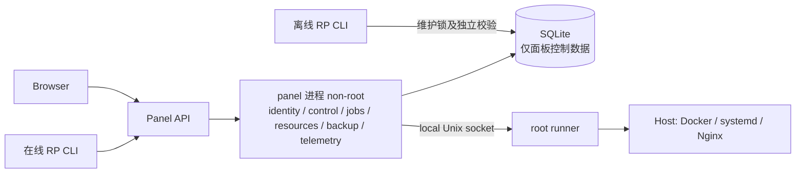
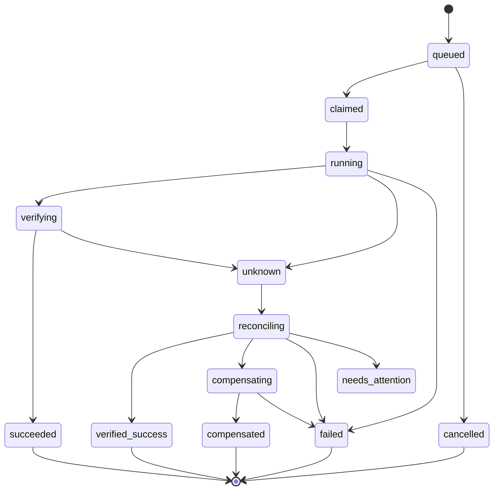

# RustPanel 开发方案 v0.3：单机 Linux 自托管服务器控制面

> 文档版本：v0.3（2026-10-11，Asia/Shanghai）
> 代码基线：`dev` / `46b6281748b44902746d34ede85678e5d52ca352`（研究所用代码基线）
> 历史版本：[开发方案 v0.2](development-plan-v0.2.md)（基线 `7d6050b`，RP-01..RP-43 任务定义原文）
> 研究依据：[Rust 作为服务器 Web 面板的优势](rust-panel-advantages.md)
> 实施状态：[开发进度](development-progress.md) · 部署前提：[安全密钥配置](security-bootstrap.md)
> **本文是设计，不是已实现的功能清单。**"设计存在"不等于"代码存在/测试通过/生产已验证"。架构、接口与阈值均为建议，多数尚未运行验证。RustPanel 为 Apache-2.0；参考产品行为独立实现，引入第三方代码单独审查许可证。

## 下一步行动（Next actions）

1. 先做 **CP0 可信底座**：独立受限 runner、非 root 面板、秘密业务接入、发布产物可验证。CP0 不完成，不对外称"生产可用"。
2. 从 [前 6 个 PR 切片](#j-pr-切片前六个) 起手，每个切片都带依赖、测试与具体 DoD；先打通一条**应用—恢复闭环**再扩功能面。
3. 主线环境固定为 Ubuntu 24.04 amd64 + systemd + Docker Engine/Compose v2 + Nginx；Debian 12 / aarch64 经独立 native 验收后再扩。
4. 优先**接管已有运行环境**，暂停默认源码编译安装器、新任意插件、多节点/K8s 与 AI 的优先级。

## A. 产品定位与范围

RustPanel 定位为**单机 Linux 自托管开发者/小团队的轻量、安全、可恢复服务器控制面**；"1Panel 实用替代"是后续目标，不是当前状态。它面向单台裸机/VM，管理网站、应用、数据库、备份与监控；**不是多租户隔离产品**——"一个面板管理服务器"意味着高权限，只读/运维角色是可信团队内的授权划分，容器特权、宿主终端、任意配置编辑都是独立受限能力。

### A.1 首批平台与用户

| 维度 | 首批范围 | 扩展（需独立验收） |
| --- | --- | --- |
| 用户 | 自托管开发者、单机运维者、小团队 | 托管服务商、多租户 |
| OS | Ubuntu 24.04 LTS、systemd | Debian 12 及以后 |
| CPU | x86_64 原生验证 | aarch64 原生验证 |
| 运维对象 | 单节点裸机/VM、现有 Docker 与宿主服务 | 多节点、K8s |
| Web 服务器 | Nginx（先验证已有）、Caddy adapter 候选、Apache 兼容实验不删除 | 其他 |
| 数据库 | 先 PostgreSQL 16（含 roles/globals） | MySQL/Redis 随后，MariaDB 等按需 |

候选兼容目标不是已验证支持列表；固定一条主线端到端后再扩矩阵，不能因"能编译"就宣布支持。

### A.2 范围控制与可验收标准

- 暂停默认源码编译安装器、新任意插件、多节点/K8s、AI 的优先级。
- 旧 Windows/macOS 原生安装、多租户计费、插件执行框架、K8s Operator 不在关键路径。
- "实用替代"的验收锚点：从干净系统安装 → 建站点 → 部署静态/反代/PHP 类应用 → 管理容器与 Compose → 管理 PG/MySQL/Redis 的账号与备份 → 配置 HTTPS 与续期 → 备份并隔离恢复 → 受限权限运维 + 审计 → 有版本契约的 API → 从 1Panel 接管的明确回退。

### A.3 三条用户旅程

| 旅程 | 流程 | 成功证据 |
| --- | --- | --- |
| 首次上线 | 干净系统安装 → 建站点 → 申请 HTTPS → 部署应用 | VM 报告 + 浏览器截图 + 续期记录 |
| 日常运维 | 改配置/升级应用 → 自动备份 → 失败回滚 | 变更事件流 + backup manifest + 回滚报告 |
| 灾难恢复 | 隔离环境恢复 DB/文件 → 健康校验 → 切换 | 恢复报告 + RTO + 未触碰生产 |

### A.4 非目标（本阶段明确不做）

- 不做多租户计费/隔离产品；不做 Windows/macOS 原生安装。
- 不做插件执行框架、多节点、K8s Operator、AI Agent 管理的优先实现。
- 不用 Rust 复刻 1Panel 全部功能来「对齐数量」；以单机开发者的可恢复运维闭环为准。

## B. 变更保留表与旧任务映射

保留：Auth/RBAC、版本化 migration（当前 schema 8）、file bounds、AES-GCM 秘密原语、audit 原语、Actix/Tokio/SQLite、原生 JS、现有 Nginx/Caddy/Apache adapter。

阶段模型：旧 M0/M1/M2 宽功能表转为 **CP0/CP1/CP2/CP3**（可靠性优先，替代范围后置）。**旧 RP-ID 不重编号**，原始任务定义保存在 [v0.2](development-plan-v0.2.md) 的 J.3；范围、优先级和演进决策以本版为准；已完成/部分/待做以 [整改记录](review-remediation.md) 为当前事实，**不把旧 C 节漏洞当作当前未修项**。

### B.1 证据边界

"路由存在"只能证明代码路径，不能推断生产可用；"测试通过"要说明测试层级与运行环境（已记录的 117 项 Rust 测试属于前轮，不是本轮 VM/浏览器/性能验证）；"生产已验证"必须有版本锁定的 VM + 浏览器 + 恢复报告。公开源码出现某能力也不代表在所有授权条件下可用。

| CP 阶段 | 主题 | 覆盖的 RP 组（按 v0.2 分组覆盖） | 退出标准 |
| --- | --- | --- | --- |
| CP0 可信底座 | 安全与可验证底座 | RP-01..RP-11、RP-12 底座、RP-13、RP-23、RP-25；RP-16 发布、RP-43 维护 CLI 子集 | 独立受限 runner + 非 root 面板；job-first 恢复竖切；秘密业务接入；CLI/SBOM 签名；性能基线 |
| CP1 应用恢复闭环 | 单条主线闭环 | RP-12、RP-14、RP-15、RP-16、RP-18 主线、RP-24 基本 UI、RP-27、RP-29、RP-30 主线、RP-36、RP-37、RP-39、RP-43 恢复扩展 | 单 HTTP+PG 应用站点经 HTTPS、备份、隔离恢复、升级失败回滚 VM 验收 |
| CP2 实用替代扩展 | 扩到替代范围 | RP-17、RP-18、RP-19、RP-20、RP-21、RP-24、RP-26、RP-28、RP-30、RP-31、RP-32、RP-33、RP-34、RP-35、RP-38 | MySQL/Redis/PHP、3 套已验证模板、S3/cron/告警、作用域 API token；1Panel 只读盘点与 adopt 最后 |
| CP3 需求驱动 | 按需求 | RP-22、RP-40、RP-41、RP-42 | 多节点/插件/AI 按用户需求与独立 RFC |

所有 RP 均可按组落到 CP0–CP3；未逐项复述标题以免与 v0.2 重复。**跨阶段子集**：RP-12 的底座（journal/lease/fencing）属 CP0、业务恢复竖切属 CP1；RP-18/RP-30 的主线子集（Compose + PG golden path）属 CP1、完整扩展属 CP2；RP-24 的基本变更 UI 属 CP1、双语扩展属 CP2。**子集交付不等于完整任务完成**：RP 原始需求保留追踪，实施切片按本版范围制定 DoD；调整原始验收条件须在任务中记录原因与覆盖关系。状态标签区分：**设计 / 代码存在 / 测试通过 / 生产已验证**——任务按自身 DoD 完成，但"支持某平台 / 宣布生产准入"必须有 VM + 恢复证据。`docs/review-remediation.md` 记录过一轮 117 项 Rust + 5 项 Node 通过，属于**前轮验证**；本轮只改文档，未重跑。

### B.2 当前实现与下一步差距

本表依据代码基线与[整改记录](review-remediation.md)，不是新的运行验收。继续保留既有回归，不重新实现已修补的认证与文件保护。

| 能力 | 当前证据 | 本版待交付 |
| --- | --- | --- |
| 认证与角色 | Argon2、可撤销会话、强制改密、权限查询和 SSE 会话绑定已有实现与回归 | 会话轮换、自动化 token 和更细资源授权按独立任务推进 |
| 数据与迁移 | schema 8、连续历史/checksum 校验和 SQLite 一致快照 | 任务/资源新迁移、版本匹配的离线恢复 |
| 文件操作 | 受管根、dirfd、原子写和元数据保持已有回归 | 其他文件写入入口覆盖、配额和宿主权限迁移 |
| 特权执行 | 进程内类型化动作、超时与输出限制 | 独立 runner、root 策略、非 root 部署和完整调用面检查 |
| 审计 | intent/outbox、结果未知状态已有实现 | runner 持久结果、作业恢复、留存与容量策略 |
| 秘密 | AES-GCM/KEK 存储与受限密钥文件 | DB/ACME/备份凭据接入与密钥恢复演练 |
| 网站与容器 | 既有站点、Docker 管理代码 | 受管资源、变更预览、Compose/PG 主线与失败恢复 |
| 发布与支持 | 锁定依赖、Rust CI 与依赖门禁 | 完整签名包、VM/浏览器/恢复报告、独立架构验收和性能基线 |

## C. 目标架构

- 面板进程**非 root**，通过**本地 Unix socket** 请求 root runner 执行受限动作。runner 是**同 crate 的独立 binary**，先不做 microservice，也不做大 cargo-workspace 重排。
- SQLite 只承载面板控制数据；runner 用**独立受限结果 journal**，**不共享可被任意改写的 DB**。
- 术语（codebase-design）：Module / Interface / Implementation / Seam / Adapter。已有 Nginx/Caddy adapter 是真实 seam；restic 先做单一 Adapter，不虚构多层 S3 plugin。
- 不每加一个 handler 就加空 trait；小 Interface 应隐藏真正的校验/发布/恢复复杂性。
- Interface 草案（**不暴露 shell**）：
  - `HostOperations`: `validate` / `apply` / `inspect(operation_id)`
  - `Changes`: `plan` / `apply` / `reconcile`
  - `Resources`: `discover` / `adopt` / `drift`
  - `Backups`: `prepare` / `snapshot` / `check` / `restore-drill`
  这些 Interface 是设计草案，返回结果必须区分权限拒绝、前置条件冲突、过载和执行结果未知；`rp` CLI 复用相同领域规则。

| Module | Interface 必须兑现的契约 | 隐藏的 Implementation |
| --- | --- | --- |
| HostOperations | 仅接收受限动作；同 operation_id + hash 返回既有结果，异 hash 拒绝；inspect 不触发重跑 | root 策略校验、限额、子进程管理、持久结果 journal |
| Changes | plan 无宿主写副作用；apply 重新检查权限、revision、计划有效期；结果未知不当作失败 | 计划展开、资源锁、job 分解、核验与补偿 |
| Resources | discover 为只读；adopt 记录唯一控制者与原始配置；检测到 drift 时阻止覆盖 | 各引擎探测、外部标识映射、配置来源和差异比较 |
| Backups | 只有导出和存储均成功才登记恢复点；check 与恢复演练分别报告 | 应用静默、数据库 dump、manifest、restic 调用、隔离恢复 |

在实际变化处建立 Seam：网站已有 Nginx/Caddy 实现可演进为 Adapter；其他单实现模块先集中职责，第二个真实实现出现时再抽象。测试通过调用者使用的 Interface 验证上述行为，不为每个 handler 增加仅转发调用的层。

### C.1 目录映射（建议，非最终）

| 现有 | 方向 |
| --- | --- |
| `src/api/v1/*` | 只保留 API 编排；降权后经 runner 请求宿主动作 |
| `src/privileged/runner.rs` | 演进为独立 binary + 协议 + journal |
| `src/repository/backup.rs` | 扩为 manifest 备份（面板 DB 仍 `VACUUM INTO`） |
| `src/bin/rp.rs` | 补齐离线恢复/维护 CLI |
| `public/` | 原生 JS 分页；前端登录改标准 HTTPS 协议 |

本轮不做 cargo-workspace 大重排，先在同一 crate 内拆出独立 binary。

- **离线 `rp` 不依赖 HTTP**：本地 root 入口取得维护锁，停止面板与 worker，确认 runner 没有未终结的相关操作，再校验备份、密钥与目标二进制支持的 schema。旧版本备份必须由匹配版本恢复，或走经过验证的升级流程；不直接灌入当前运行库。
- 维护锁必须同时被正常启动、任务提交和离线维护遵守。离线 CLI 在进程已停止时复用领域校验与恢复逻辑，不以“Web 不可用”为理由绕过前置条件。

## D. 权限与 runner

- socket 属 `root:rustpanel`、模式 `0660`，父目录 root-owned 且 panel 对其**无 write**；用 `SO_PEERCRED` 校验已安装的 panel uid；离线维护另有明确的本地 root 入口，**不信 actor id 自报**。
- server-owned policy 与 runner journal 均 **root-owned、panel 不可修改**；policy 含 resource allowlist、known units、绝对可执行路径、清洗环境、版本化协议、有界 request/output/deadline。协议层的内容长度/hash 检查**只保证一致性、不等于安全**，白名单指令/path/unit 及语义检查由 runner **独立执行**。
- **所有 Docker host 变更迁到 runner**，包括 API 可能访问 host fs 的读取；panel **不得**加入 `docker` 组或直接访问 docker socket。
- Compose 解包后约束 `privileged`、host mount、`devices`、`hostnetwork`、capabilities、build/exec；模板固定 digest/arch 与 catalog policy。
- 普通运维默认**不允许**任意 `extra_config`、任意 unit 或 reload 路径。systemd 动作仅作用于已接管的 allowlist unit；Compose 只操作通过策略验证且拥有明确资源标识的项目。
- runner **不直接执行面板提供的任意配置文件**：验证 content hash、config directive、path ownership，**禁止 symlink**。
- `SO_PEERCRED` 只证明对端进程，**不保护被攻陷的 panel**；runner 缩小动作面，但不是面板被攻陷时的完全免疫。
- 面板 systemd unit 使用 `NoNewPrivileges`、`ProtectSystem`、受限 `ReadWritePaths` 和能力集；runner 按实际动作保留所需权限，逐项验证，不能复制一组限制后就宣称有效隔离。
- journal root-owned；动作接受记录先 fsync，结果持久化后才应答。容量满或接受记录写失败时不启动新动作；动作已发生却无法持久化结果时进入 `unknown`，不能声称副作用已撤销。
- **秘密**：现阶段面板 KEK `0600` 契约不改；未来按 operation 把凭据**最短物化到受限文件/FD**，不落 argv/log/plain plan。KEK 恢复分"保管"与"真实演练"。

### D.1 信任边界

信任等级：root runner > 非 root panel > 浏览器用户。面板被攻陷是**高风险**：runner 限制它能触发的动作面，但 `SO_PEERCRED` 只证明进程身份；**即使只触发 allowed host 动作也仍有数据风险**（删除/覆盖/导出）。因此 policy 必须最小授权，journal 独立于面板 DB，且 runner 对被攻陷面板不提供完全免疫。

## E. 计划与资源模型

- `resource`: `uuid` / `kind` / `owner` / `observed|managed` / `revision` / `spec_hash` / `observed_hash` / `external_id` / `provenance`。
- `change plan`: `schema` / `resource` / `expected_revision` / `action_hash` / `redacted_steps` / `preconditions` / `deadline` / `quota` / `data_compatibility` / `rollback_kind` / `expires`。
- 协议：`POST /changes/preview` → `POST /changes/apply`（带 `plan_id` / `hash` / `idempotency_key`）→ `202 change_id` / `jobs` → `status` / `events`。先实现**一个真实动作**的恢复闭环。
- UI 预览必须明确：目标资源、是否影响数据、是否备份、可逆性、预计停机；**显示 unknown**，不编造失败或成功。
- 外部 drift：**不覆盖**，先只读 observe，再由用户 `explicit_adopt`；保证同一资源只有一个控制者，避免与 1Panel 或其他工具并发改写；**没有资源全局持续 desired-state 自动写入**。

### E.1 资源类型（首批）

`website`（Nginx server block）、`certificate`（ACME/证书 owner）、`compose_project`、`service`（systemd unit）、`database`（PG cluster/role）、`backup_target`。每种资源都要有 `discover`/`drift` 语义与明确的 adopt 路径。

## F. 作业状态与恢复

- 区分 `queued` 取消与运行中取消；**不存在自动 exactly-once**。运行中取消是请求：待确认子进程退出、外部状态及补偿结果后才确定最终状态。
- `succeeded` 需要验证动作的后置条件；退出码 0 只是一项证据。`failed` 表示失败已确认，仍须说明是否有部分副作用；无法核验时使用 `unknown`/`needs_attention`。补偿执行失败也必须记录，不能直接显示“已回滚”。
- `job_id` / `change_id` / `operation_id` 分工明确；**lease generation/fencing 由 runner 强制执行**；resource lock 初期全局 1 个 mutating，多资源按稳定顺序。
- 同 `id` 同 `hash` 结果复用；不同 `hash` 返回 `409`。
- runner 在 **spawn 之前**持久化接受记录，动作结束后持久化结果；结果 fsync 之后才回控制面；**应答丢失时先 inspect，不重跑**。
- 租约过期**不意味着**旧子进程已停；新 generation 需等到旧 exec 已验证退出，否则 `needs_attention`。
- 已启动的 `spawn_blocking` 不能靠 abort 停止。宿主子进程需要显式取消、管理进程组并等待退出；当前 Docker exec 响应超时只结束 attachment，需按 exec_id inspect 核验远端状态。
- DB 短事务**不等待**外部命令。

失败场景表：

| 窗口 | 期望行为 |
| --- | --- |
| before intent | 拒绝执行，无副作用 |
| after accepted / before effect | **不盲重试**：先 inspect + reconcile，证实无副作用且动作安全幂等才可重试 |
| after effect / before result | `unknown` → reconcile |
| DB outbox fail | 结果 journal 可 inspect；outbox 仅**有限重投**，**不重跑 action** |
| disk full | 执行前拒绝；执行后 `unknown` + inspect，人工判断；**不声称 fail-closed 撤销已 effect** |
| worker crash | lease 过期 → 验证旧进程退出 → reconcile |
| reload fail | 回滚配置 + probe，**数据不自动回滚** |

### F.1 job / change / operation 分工

| 标识 | 含义 | 生命周期 |
| --- | --- | --- |
| `change_id` | 一次用户可见的变更意图 | preview→apply→done |
| `job_id` | 一次后台执行单元 | queued→…→succeeded |
| `operation_id` | runner 内单次宿主动作 | accept→result |

一个 change 可含多个 job；一个 job 可含多个 operation。审计与幂等键分别绑定到对应层。

**租约与 fencing**：runner 为受管资源持久记录 generation 高水位并拒绝旧 generation 请求；重启后先核对未终结 operation。持久 generation 不能单独证明旧执行进程已停，需核对 systemd/cgroup、Docker exec 等外部标识；仅凭 PID 不足以排除 PID 重用。无法证明旧动作状态时阻止相同资源的新写入并请求人工处理。

初期限制全局一个宿主写动作，多资源操作以稳定次序取得锁。SQLite 控制库事务只做短时状态变化，不持有事务等待外部动作；runner journal 是独立恢复证据，不与 SQLite 假装组成事务。先做单机、单 runner，**不承诺跨主机 exactly-once**。

## G. 端到端闭环

### G.1 网站与证书

- **Nginx 站点**：candidate validate → atomic publish + fsync → reload → probe → commit；配置回滚后 reload/probe，**数据回滚不自动**。
- **HTTPS**：Nginx 用既有 ACME 迁 `secret_ref` 与 job；Caddy 原生 ACME 独立 owner 将来做（**不能双 ACME owner**）；当前保持 panel 走 loopback + 受信 TLS 代理。
- 既有 Nginx/Caddy adapter 继续支持 seam；Apache 走兼容实验，不删除。

### G.2 容器与 Compose

- 规范：validate、reject 危险选项、固定 digest、保留 volumes、**不用 `down -v`**、health 检查、data upgrade check，停止需 preview。
- 可重建容器**不自动**等于数据可回退；Compose 单机生产复用需按官方文档条件。

### G.3 数据库备份

- **PostgreSQL**：原生 `pg_dump`/restore + roles/privileges/scopes，**不做"事务回滚"式失败声明**（单库 dump 一致快照，各库非同步，roles/globals 另存）。
- **restic**：用于传输/加密/去重 repo，**不代替**面板 DB 的 `VACUUM INTO`、PG 逻辑 dump、应用 quiesce。
- `mysqldump | restic --stdin` 可能把上游导出失败掩盖为成功存储空输入；须校验整个导出链的退出码，优先直接调用 restic `--stdin-from-command` 或验证成功的暂存文件。
- `restic check` 默认不读全部数据，需 `--read-data`/`--read-data-subset`，且**不等于应用恢复**。
- **manifest**：格式版本、资源标识、数据/配置 hash、密钥引用、引擎与工具版本、镜像 digest、导出时间区间、静默方式、一致性级别与恢复前置条件。记录实际恢复点与 RPO，不仅记录任务完成时间。
- PG dump 与应用文件分别成功不代表跨资源快照一致；首条主线需要应用写入静默窗口与相关后台任务处理，并在恢复报告中验证业务关联数据。无法实现应用一致时明确标注能力，不能宣称一致恢复点。
- KEK 与 restic 仓库凭据按独立恢复流程保管。manifest 只记录引用与版本；普通备份包不得包含可直接解密同包数据的明文 KEK。恢复演练要涵盖密钥不可用和错误密钥。

### G.4 恢复与运维 CLI

- **隔离恢复**：独立 network/volumes，默认阻断外部邮件、支付回调和定时任务；恢复 DB/文件后核对健康状态与业务数据，报告 RTO 和恢复点。完整过程不得覆盖生产资源。
- **恢复 CLI 在 Web 挂掉时仍可用**（本地 root + maintenance lock）。S3 + cron retention 后扩；`restic check` 数据与业务恢复**都要验收**。
- **外部 migration**：explicit adopt；一旦有新写入，**不能用旧 snapshot 覆盖**。
- **防火墙 watchdog** 独立于 panel，需 VM 测试，默认**不开写**。
- 首次验收形态：单线 `app(HTTP+PostgreSQL16) → Nginx HTTPS → local backup → isolated restore → upgrade recover`。

## H. 前端、API、可观测与数据版本

- 保留原生 JS，按 resource/change/job/backup 分页；共享 status/error/accessibility/i18n；API 授权独立于 UI 隐藏。
- 可观测：关联 request/change/operation id，输出结构化日志并脱敏；监控历史设置留存与查询范围；通知由 outbox 有限重试。高基数标识留在日志/事件中，不作为指标标签。
- 内存预算：SSE 有界、有界队列、blocking semaphore、login argon 配额；**插件不默认加载**。
- Schema：**只新增 009+，绝不修改迁移 1–8**。升级前备份数据库、配置和密钥恢复材料；回退只使用相互匹配的二进制与数据库，不能让旧二进制读取新 schema。runner 协议版本独立协商；安装 manifest 记录每个产物和 schema 版本。
- 依赖整顿：集中 HTTP client 与 sysinfo；**评估 rustls 但不承诺 pure-static**；Diesel 业务 + `rusqlite` 仅专用用途——先写清职责再简化。
- SM4 旧前端登录改标准 HTTPS 协议属**独立 compat 切片**；HTTPS 才安全，不把 SM4 当传输安全。
- **兼容不自动接受 N/N-1**：连接/协议握手协商明确的 `supported_versions`，无法协商就 **fail-closed**，不静默降级。
- **SBOM/签名覆盖二进制、前端、配置样例及 manifest**，不把实例私钥与运行凭据打进发布包。发布时保留匹配的未压缩调试符号或诊断产物；**musl/UPX 不是静态链接成功或性能优势的证据**。
- **unsupported legacy writes 迁 runner 前先关写/只读**，不能让 non-root 面板继续以 priv 方式绕过 runner。

### H.1 资源配额与可观测指标

实现必须为作业队列、SSE 缓冲、日志输出、阻塞工作、登录口令计算和 journal 分别定义配置上限与过载行为。待运行作业过多时拒绝新提交；慢消费者断开后可按任务事件游标恢复；口令计算先取得限额再启动，不让请求超时留下无限后台工作。数值在 CP0 基线后确定，配置不是现有功能承诺。

指标覆盖请求延迟、作业队列深度、租约过期、runner 拒绝数、备份/校验失败、SSE 活动连接与丢弃数。指标和事件都要有留存与容量上限；审计清理不得先删未处理结果，达到安全容量上限时阻止新高危动作。资源满时的 UI 提示、重试条件和诊断记录均属验收范围。

## I. 里程碑

| 阶段 | 任务/依赖 | 交付 | 验收 |
| --- | --- | --- | --- |
| CP0 | runner 权限 + job-first 恢复竖切 + 秘密业务 + CLI/release SBOM 签名 + 基线 | 非 root 面板、受限 runner、可验证产物 | VM 上拒绝越权、job 恢复、产物可验签、基线报告 |
| CP1 | 单 HTTP+PG 应用站点 → HTTPS → 本地备份 → 隔离恢复 → 升级失败回滚 | 一条主线闭环 | VM + 浏览器端到端 + 恢复报告 |
| CP2 | MySQL/Redis/PHP、3 validated templates、S3/cron/alerts、OpenAPI 作用域 token；1Panel 只读盘点与 adopt 最后 | 实用替代范围 | 三模板三 DB 各自恢复演练；接管/回退报告 |
| CP3 | 多节点、插件、AI | 按需求 | 独立 RFC 与安全/运维成本核定 |

**里程碑定义**：evidence 链接 tests/artifact/VM version；严格区分"设计 / 代码存在 / 测试通过 / 生产已验证"。`secrets` 与 signed release 是 CP0 横向项，不能落掉；**未过门禁不宣布生产**。

### I.1 CP 验收细化

- CP0：VM 演示 non-root 面板无法直连 docker socket；runner 拒绝未知 unit/路径；`rp` 可验签；基线报告含 PSS/RSS/p95。
- CP1：干净 VM 走完 app→Nginx→HTTPS→备份→隔离恢复→升级失败回滚；浏览器端到端可见 unknown 状态。
- CP2：三套模板 + 三 DB 各自恢复演练；S3/cron/告警；OpenAPI 作用域 token 只给最小权限。
- CP3：多节点/插件/AI 先出 RFC，再定安全与运维成本。

## J. PR 切片（前六个）

| # | 切片 | 依赖 | 测试 | 风险 | 具体 DoD |
| --- | --- | --- | --- | --- | --- |
| 1 | runner protocol + journal/inspect（RP-07/09） | — | 协议单测、journal 重放 | 协议版本兼容 | 协议版本化；inspect 可在 lost ack 后不重跑 |
| 2 | 非 root 面板 + 路由审计 + VM deny（RP-07） | #1 | VM 越权拒绝、审计用例 | 权限回归 | panel 无 docker socket；越权动作 VM 上被拒 |
| 3 | Changes/Jobs 首个 systemd unit 恢复（RP-12/09） | #1,#2 | 状态机、fencing、失败注入 | 未知结果处理 | `queued→running→unknown→reconciling` 可复现 |
| 4 | managed Nginx 原子流程（RP-27） | #3 | validate/publish/reload/probe | reload 失败 | 失败可回滚，drift 不覆盖 |
| 5 | 本地 manifest 备份 + 离线 CLI 恢复（RP-15/29/43） | #3 | 备份校验、隔离恢复 | 空备份/错 key | 坏包不覆盖目标；恢复 CLI 独立可用 |
| 6 | Compose + PG + HTTP golden path（RP-18/30/08） | #4,#5；secrets 业务接入 | 端到端、数据升级 | 卷/一致 | 主线闭环 VM 通过；secret_ref 接入 |

首六个切片覆盖执行与恢复主线；RP-08 秘密接入、RP-11/RP-16 发布验签、RP-23 会话轮换和 RP-39 配额/基线是独立追踪的横向任务。保留既有 Argon2/RBAC/迁移/SSE/文件边界回归；不能因为先做执行器就重新放开敏感路由。

工期在前两个切片完成后，根据实测吞吐量与 VM 验证成本估算。每个切片提交须附代码范围、兼容策略、失败注入结果和部署限制；不先承诺日历日期。

## K. 性能验证

无既有性能结果。提议：2 vCPU / 1 GiB VM、版本锁定、idle 30 分钟；10/50 个 SSE 慢消费者；bounded tail；2 个并发 job + auth bursts；restart/recover/disk full。

报告：panel 与 runner 的 PSS/RSS + cgroup peak；worker 线程记录数量与队列指标，独立 worker/子进程记录占用；线程不重复计入进程 PSS 合计；web 代理与应用分开计量；CPU 使用率、启动时间、请求与队列延迟 p95/p99；FD/threads；WAL growth；binary/artifact size。

对比纪律：`opt-level=z` vs `3` 必须同提交、同工具链、同负载（只比 profile，不比不同功能）；与 Go/1Panel 等实现比较需隔离运行，采用共同功能集、等效部署条件，并记录各自依赖与配置；cold/warm 分开，**只写观测，不做 Rust 因果主张**。临时目标：panel + runner 空闲合计 PSS ≤ 128 MiB、avg CPU < 1% 单核、连接关闭、作业完成后资源不持续累积；负载内存门在定基线后结合 argon/config 制定——**这不是实现承诺**，CP0 报告后再修订目标。

### K.1 与 Go/1Panel 比较纪律

共同功能集、等效部署条件、同负载，分别记录依赖与配置，cold/warm 分开；只报告观测值，不做「因为用 Rust 所以更快/更省」的因果主张。旧 1Panel v2.3.2 是历史比较对象，不称目前最新版；本轮未重新测 1Panel。

## L. 风险与决策表

| 风险 | 决策 |
| --- | --- |
| root runner 策略绕过 | server-owned policy + 绝对路径 + 禁 symlink + VM deny 测试 |
| 数据格式回滚 | 先备份后升级；schema 只加不改；匹配 binary/DB |
| restic 外部依赖 | 视为外部依赖；exit 全检查；不当作应用恢复 |
| SQLite 写入与执行并发 | 控制库短事务，显式配额与锁；单 runner 不意味着外部动作天然 exactly-once |
| scope creep / 编译成本 | 冻结范围；CP3 按需求；不为功能加复杂度 |
| 证书 owner | Nginx ACME 与 Caddy ACME 各自独立，不双 owner |
| 网络 FS 上的 SQLite | 拒绝网络文件系统；WAL 要求同主机 |
| stock installer root | 默认安装器仍需限制权限与审计 |

**验证失败不加 features**：任何回归先修不掩，不通过就不扩大功能面。

## M. 引用与术语

术语：**Module / Interface / Implementation / Seam / Adapter**（codebase-design）；**CP0–CP3** 见 B 表；**evidence** 指可链接的测试/产物/VM 版本。

外部依据（查阅日 2026-10-11，均为动态文档）：

- [Rust 所有权](https://doc.rust-lang.org/book/ch04-01-what-is-ownership.html)
- [Rust unsafe/FFI](https://doc.rust-lang.org/book/ch20-01-unsafe-rust.html)
- [Tokio spawn_blocking](https://docs.rs/tokio/latest/tokio/task/fn.spawn_blocking.html)
- [Tokio mpsc 背压](https://docs.rs/tokio/latest/tokio/sync/mpsc/index.html)
- [Cargo profiles](https://doc.rust-lang.org/cargo/reference/profiles.html)
- [Docker 安全](https://docs.docker.com/engine/security/)
- [SQLite WAL](https://sqlite.org/wal.html)
- [systemd.exec](https://www.freedesktop.org/software/systemd/man/latest/systemd.exec.html)
- [Compose 生产](https://docs.docker.com/compose/how-tos/production/)
- [Caddy 自动 HTTPS](https://caddyserver.com/docs/automatic-https)
- [restic 仓库](https://restic.readthedocs.io/en/stable/045_working_with_repos.html)
- [restic 备份](https://restic.readthedocs.io/en/stable/040_backup.html)
- [PostgreSQL dump](https://www.postgresql.org/docs/current/backup-dump.html)
- [Go GC guide](https://go.dev/doc/gc-guide)
- [TypeScript 类型擦除](https://www.typescriptlang.org/docs/handbook/2/basic-types.html)
